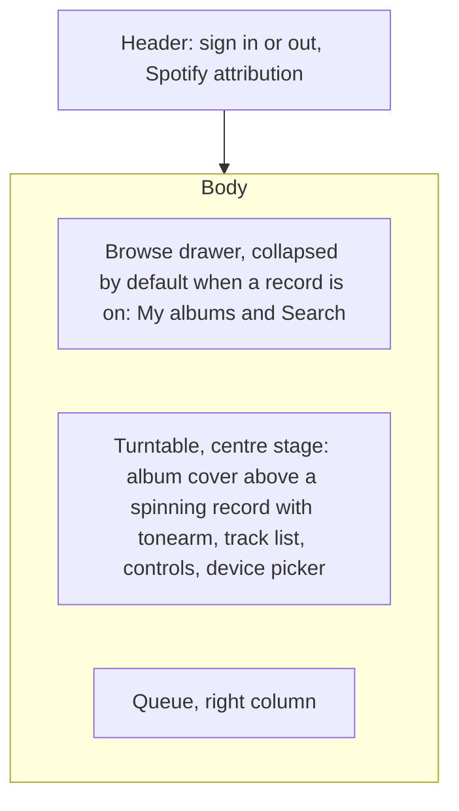
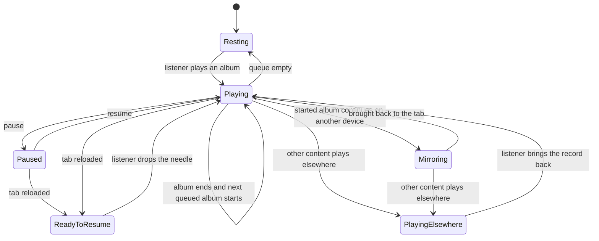
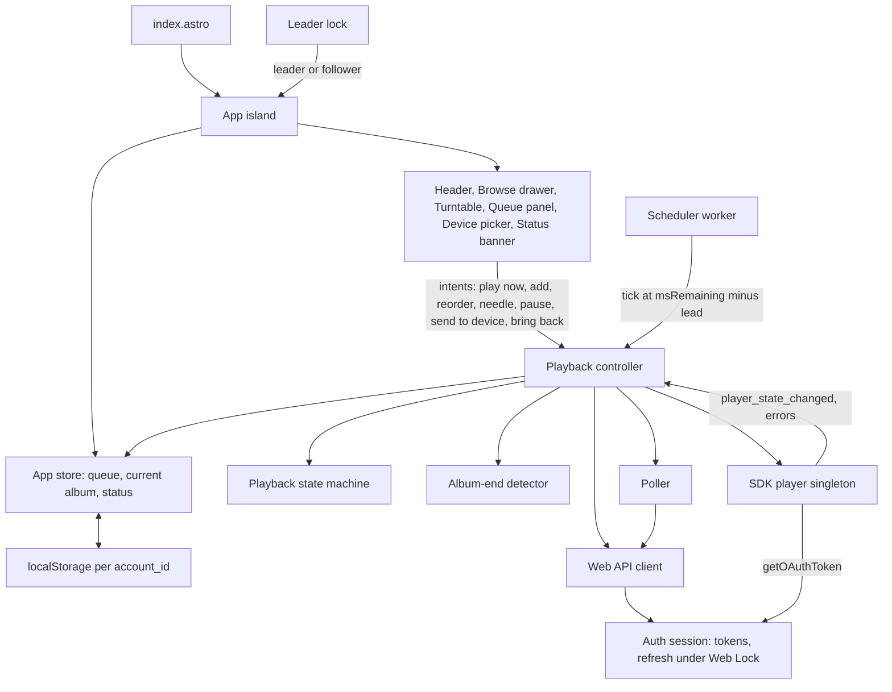
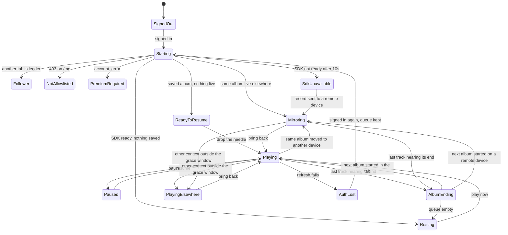
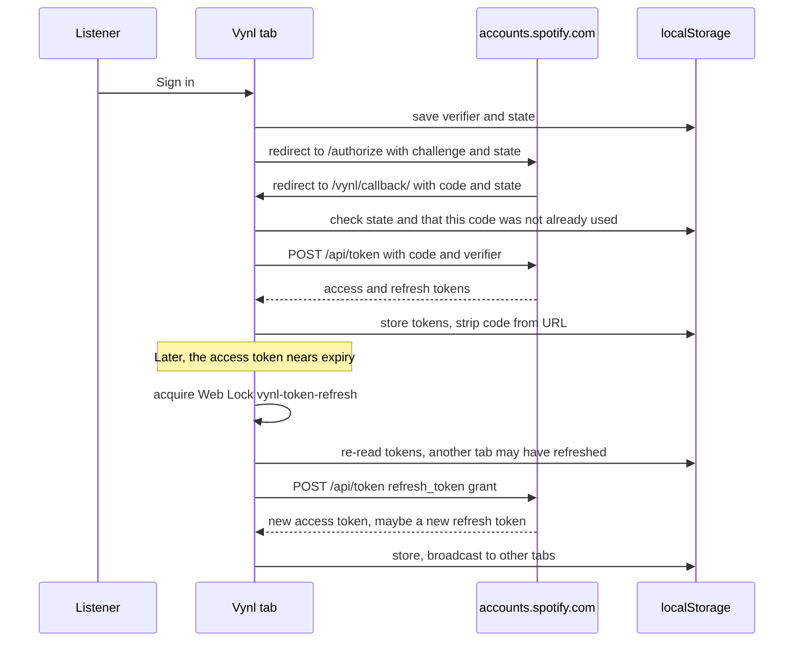
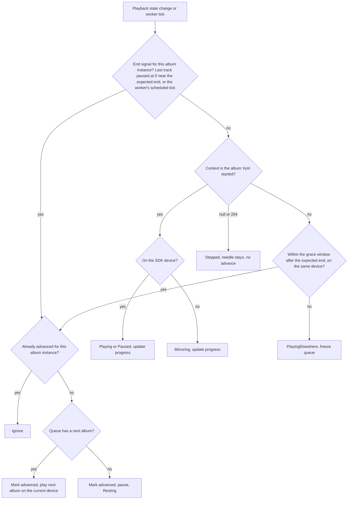

# Spotify Vinyl Player - Plan

## Goal Capsule

- **Objective:** A signed-in Spotify Premium listener can line up whole albums and hear them play from the browser, while a turntable on screen spins the record, shows its cover, and moves its tonearm in step with the music.
- **Means:** A static Astro site on GitHub Pages with a single React app that signs in to Spotify from the browser and plays whole albums through Spotify's in-browser player (KTD1, KTD2, KTD4, KTD10).
- **Product authority:** This Product Contract. The project owner (dcyoung-dev) decides changes to scope or behaviour.
- **Execution profile:** New build on a bare Astro starter. Units run in U-ID order. U6 is a hands-on spike with a real Premium account, and it must finish before U8 starts.
- **Stop conditions:** Stop and ask the owner in either case:
  - The U6 spike shows that album end can't reliably be told apart from Spotify's autoplay within the KTD5 grace window.
  - A Spotify API change removes an endpoint or SDK event that a KTD depends on.
- **Finishing and shipping:** `ce-work` builds and verifies locally. The owner does the account-side setup in the Spotify dashboard and GitHub settings (U2), then merges to `main`, which deploys the site.
- **Open blockers:** None.

---

## Product Contract

Product Contract preservation:
- changed: R10, R12 — Spotify's design guidelines forbid altering cover art (user-directed).
- added: R22 and its Key Decision — the owner supplied a colour palette.
- updated: the hosting assumption, from Cloudflare to GitHub Pages.

### Summary

Vynl is a browser-only, album-only Spotify player that puts a vinyl turntable centre stage. Listeners choose albums from their saved library or from search, queue them up, and watch a gently warped record spin with its cover above it while the tonearm tracks the album's progress. Playback happens in the tab by default and can be sent to another Spotify device.

The build is a static Astro site on GitHub Pages with one React app inside it. That app signs in with Spotify's browser-only flow, plays albums through Spotify's in-browser player, and keeps everything in localStorage. Before the polished interface is built, a short spike against a real account confirms how album endings and device hand-offs actually behave.

### Problem Frame

Spotify is built around tracks, playlists, and endless recommendations. Putting on one album and listening to it start to finish, the way you would with a record, is possible but never the point of the interface, and nothing about it looks or feels like playing a record. This is a personal showcase for the owner and a few friends: a small, polished example of what a focused listening experience on top of Spotify can feel like, deployed as a static site with no server to run.

### Actors

- A1. Listener: the owner or an allowlisted friend with Spotify Premium, using a desktop browser.
- A2. Spotify: the identity provider, catalogue, and playback service. It also enforces who may use the app.
- A3. Other Spotify devices: the listener's phone, desktop app, or speakers, which can receive or take over playback.

### Key Decisions

- **Personal showcase for the owner and up to four friends.** Spotify's development-mode cap of 5 allowlisted users is acceptable and no public launch is planned. Governs R1, R2. (session-settled: user-directed — chosen over a public demo or a learning-only project: it is meant to be used by a small known group)
- **Turntable centre stage, browsing in a drawer.** This supersedes the opening idea of a small player at the side. Governs R11, R12. (session-settled: user-directed — chosen over a browse-first page with a side turntable and over a three-column layout, after seeing rough sketches of all three)
- **Browser plays by default, with a "send to device" option.** Governs R18, R19. (session-settled: user-directed — chosen over browser-only playback (the recommendation) and over a remote-control turntable that makes no sound itself)
- **Mirror outside playback only when it is the album Vynl started.** Governs R20, R21. (session-settled: user-directed — chosen over lifting the needle and pausing as soon as playback leaves the tab; narrowed by a user-approved follow-up to the started album only, rather than mirroring any content)
- **Album-only.** Vynl never starts single tracks, playlists, or podcasts. Governs R5, R6.
- **Free movement within an album.** Listeners can pause, skip, and "move the needle" to any track, but cannot seek within a track. Governs R8, R9. (session-settled: user-approved — proposed over strict start-to-finish play and over full seeking)
- **Reorderable album queue that auto-advances.** Governs R15, R16. (session-settled: user-approved — proposed over an add-only stack and over pausing between albums)
- **Resume from a reload, but never autoplay.** Governs R17. (session-settled: user-approved — proposed over remembering the queue only and over adding a recently-played shelf)
- **Visual authenticity without audio effects.** No crackle or added sound; the vinyl feel comes from the spinning, warped record and the moving tonearm. Governs R12, R13, R14.
- **Printed text label instead of cover art on the record.** Spotify's design guidelines forbid cropping, animating, or overlaying album artwork, so the unaltered square cover sits above the turntable and the record's label carries the album and artist name. Governs R10, R12. (session-settled: user-directed — chosen over a plain coloured label and over keeping the cover-art label against the guidelines)
- **Vynl's own five-colour palette.** The owner chose the palette in R22. Governs R22. (session-settled: user-directed — chosen over Tailwind's default colours and over one-off hex values in custom CSS)

### Requirements

**Access and sign-in**

- R1. A listener signs in with their Spotify account directly from the browser, with no Vynl server involved.
- R2. A listener who can't play (no Premium, or not on the app's allowlist) sees a clear explanation instead of a broken player.
- R3. Signing out clears the listener's Spotify session from the browser.
- R4. Spotify attribution is visible, and every album shown links back to that album on Spotify.

**Finding albums**

- R5. The browse drawer offers the listener's saved albums and a search across Spotify's album catalogue.
- R6. Only albums can be chosen; search and browse never offer single tracks, playlists, or podcasts to play.
- R7. From any album the listener can either play it now or add it to the end of the queue.

**Playing a record**

- R8. An album plays its tracks in order from the first track unless the listener moves the needle.
- R9. The listener can pause, resume, skip to the next or previous track, and jump to any track in the current album's track list.
- R10. Cover art and the current track's details are shown whenever audio plays. Cover art always appears square and unaltered, with only lightly rounded corners and nothing drawn over it.

**The turntable**

- R11. While a record is on, the turntable is the dominant element on the page, with the album cover shown above the record, the queue beside it, and browsing tucked into a slide-out drawer.
- R12. The record's centre label shows the album and artist name as printed text, and the record spins only while audio plays. The album cover is never drawn on, cropped into, or animated as part of the record.
- R13. The record spins with a slight uneven wobble, as if gently warped with age.
- R14. The tonearm rests off the record when nothing plays, sets down when playback starts, and moves inward in proportion to progress through the whole album, jumping when the listener moves the needle.

**Queue and persistence**

- R15. The queue is an ordered list of albums the listener can add to, remove from, and reorder.
- R16. When an album finishes, the next queued album starts automatically; when the queue is empty, the record stops and the tonearm returns to rest.
- R17. The queue, the current album, and the position within it are kept in the browser, so a reload shows the same record ready to resume, and playback only restarts when the listener acts.

**Devices**

- R18. Audio plays in the browser tab by default.
- R19. The listener can send the current record to another of their Spotify devices, and the turntable keeps spinning in step while Vynl keeps advancing the queue for as long as the tab is open.
- R20. If playback moves to another device outside Vynl and is still the album Vynl started, the turntable mirrors it: spinning, tonearm position, and track.
- R21. If anything other than the album Vynl started plays elsewhere, the turntable stops, shows that Spotify is playing elsewhere with a way to bring the record back, and the queue pauses.

**Look and feel**

- R22. The interface is coloured from Vynl's palette: dark slate, honey bronze, muted teal, vanilla custard, and night bordeaux, plus a neutral black for the vinyl itself. Spotify's logo and album artwork keep their own colours.

### Layout

The layout direction chosen from the rough sketches (directional, not a visual spec):



### Key Flows

- F1. First listen
  - **Trigger:** A listener opens Vynl with nothing saved.
  - **Actors:** A1, A2
  - **Steps:** Sign in; the empty turntable invites browsing; the drawer opens; pick an album and play it now; the tonearm sets down and the record spins.
  - **Covered by:** R1, R5, R7, R11, R12, R14
- F2. Building a listening session
  - **Trigger:** A record is playing.
  - **Actors:** A1
  - **Steps:** Open the drawer; search or browse; add albums to the queue; reorder them; the current album ends and the next starts on its own.
  - **Covered by:** R5, R7, R15, R16
- F3. Moving the record
  - **Trigger:** The listener wants sound from their speakers rather than the laptop.
  - **Actors:** A1, A3
  - **Steps:** Open the device picker; choose a device; sound moves there; the turntable keeps spinning and the queue keeps advancing.
  - **Covered by:** R18, R19



### Acceptance Examples

- AE1. **Covers R2.** Given a friend signs in with a free Spotify account, when Vynl loads, then they see a message that Premium is required, and no player controls appear to fail.
- AE2. **Covers R14, R9.** Given track 3 of a 10-track album is playing, when the listener moves the needle to track 8, then the tonearm jumps inward to that point in the album and keeps tracking from there.
- AE3. **Covers R16.** Given the last track of the last queued album ends, when playback stops, then the record stops spinning and the tonearm lifts back to rest.
- AE4. **Covers R17.** Given an album is halfway through and the tab is reloaded, when the page returns, then the same cover and record show at that point with the tonearm in place, and no audio plays until the listener presses play.
- AE5. **Covers R19.** Given the listener sends the record to a speaker and leaves the tab open, when the album ends, then the next queued album starts on the speaker.
- AE6. **Covers R20.** Given Vynl started an album, when the listener opens Spotify on their phone and the same album continues there, then the turntable keeps spinning and tracks the phone's progress.
- AE7. **Covers R21.** Given Vynl is playing, when the listener starts a playlist on their phone, then the turntable stops, shows "Playing elsewhere" with a bring-it-back action, and the queue does not advance.

### Success Criteria

- The owner would happily show it to a friend: the spinning record, wobble, and tonearm read as "playing a record" at a glance, not "Spotify with a picture".
- An evening of queued albums plays through without the listener touching anything between albums.

### Scope Boundaries

**Deferred for later**

- A recently-played shelf of past albums.
- Side A and Side B, or flipping the record.
- Polished mobile layouts. Mobile should work, but desktop comes first.

**Outside this product's identity**

- Crackle, hiss, or any other added audio effect.
- Playing single tracks, playlists, or podcasts.
- Public sign-up or more than Spotify's development-mode user cap.
- Any Vynl server or account system.

#### Deferred to Follow-Up Work

- Playwright browser tests that run against `bun run preview` with Spotify stubbed. This plan relies on Vitest plus a manual Spotify smoke check.

### Dependencies / Assumptions

- **Stack and hosting:** Astro, Bun, React, and Tailwind, deployed as a static site to GitHub Pages from the public repo `dcyoung-dev/vynl` at `https://dcyoung-dev.github.io/vynl/`, with all state in localStorage. The repo currently installs only Astro (`package.json`), so adding React and Tailwind is part of the work.
- **Spotify access:** a Spotify developer app in development mode, owned by a Premium account, with each listener added to its allowlist by hand (up to 5 users). Extended access is only granted to organisations with 250k+ monthly users, so it is not a path for this project.
- **Premium:** every listener needs Spotify Premium for in-browser playback and device control.
- **Browser-only sign-in:** Spotify's authorisation-code-with-PKCE flow allows sign-in with no server-held secret. Redirect URIs must use HTTPS in production (`https://dcyoung-dev.github.io/vynl/callback/`) and a loopback IP in local development (`http://127.0.0.1:4321/vynl/callback/`), because Spotify rejects `localhost`.
- **Token storage:** Spotify tokens live in localStorage. That is acceptable for a personal showcase, but any script injection on the page could read them.
- **Non-commercial use:** Spotify's playback SDK and developer policy forbid commercial use without written approval; this project stays personal.
- **Browser autoplay rules:** audio can't start without a user gesture, and iOS has extra limits on that. R17 already assumes this.

### Outstanding Questions

**Deferred to Implementation**

- The exact album-end grace window, the lead time before handing the next album to a remote device, and the polling intervals. The U6 spike sets these numbers; KTD5 and KTD6 fix the approach.
- How the warped wobble and the tonearm motion are tuned (U10). This is cheap to iterate on by eye.

### Sources / Research

- Spotify quota modes, including the 5-user development cap and extended-access criteria: https://developer.spotify.com/documentation/web-api/concepts/quota-modes
- Spotify Web Playback SDK, including browser support, iOS limits, and the non-commercial clause: https://developer.spotify.com/documentation/web-playback-sdk
- Spotify redirect URI rules, including no `localhost` and HTTPS outside loopback: https://developer.spotify.com/documentation/web-api/concepts/redirect_uri
- Astro's guide to deploying on GitHub Pages: https://docs.astro.build/en/guides/deploy/github/
- Spotify Developer Policy on attribution, link-back, showing cover art during playback, and not replacing core Spotify experiences: https://developer.spotify.com/policy
- Spotify design and branding guidelines, covering unaltered cover art and logo sizes: https://developer.spotify.com/documentation/design
- Spotify's February 2026 Web API changes, which narrowed development mode: https://developer.spotify.com/documentation/web-api/references/changes/february-2026
- Spotify's July 2026 change that shares the quota per developer account: https://developer.spotify.com/documentation/web-api/references/changes/july-2026
- Spotify's PKCE and token-refresh tutorials: https://developer.spotify.com/documentation/web-api/tutorials/code-pkce-flow and https://developer.spotify.com/documentation/web-api/tutorials/refreshing-tokens
- Spotify's "Start/Resume Playback" endpoint, which notes that the order of player commands is not guaranteed: https://developer.spotify.com/documentation/web-api/reference/start-a-users-playback
- Chrome's intensive timer throttling in background tabs: https://developer.chrome.com/blog/timer-throttling-in-chrome-88
- Astro configuration reference, covering `site`, `base`, `trailingSlash`, `server` and `security.csp`: https://docs.astro.build/en/reference/configuration-reference/
- Tailwind v4 theme variables (`--color-*` in `@theme`): https://tailwindcss.com/docs/theme
- `withastro/action`: https://github.com/withastro/action

---

## Planning Contract

### Key Technical Decisions

**App shape and platform**

- KTD1. **One `client:only="react"` app, with plain TypeScript logic beneath it.** `src/pages/index.astro` mounts a single `App`. State lives in a `useReducer` store exposed through React context. Sign-in, the queue, album-end detection and the playback state machine are framework-free modules under `src/lib/`, so Vitest can test them without the Spotify SDK or a browser. There is only one island, so Nano Stores and server rendering of the player add nothing.
- KTD10. **Project-site base path with one URL helper.** `astro.config.mjs` sets these options:
  - `site: 'https://dcyoung-dev.github.io'`, `base: '/vynl'`, `trailingSlash: 'always'`;
  - `server: { host: '127.0.0.1', port: 4321 }` with `vite.server.strictPort: true`.

  `src/lib/url.ts` builds every internal link and the Spotify redirect URI (`<origin>/vynl/callback/`) from `import.meta.env.BASE_URL`. Nothing hard-codes `/vynl`. The app is always opened at `127.0.0.1`, never `localhost`, because Spotify rejects `localhost` and localStorage is per-origin.
- KTD11. **Content security policy as a meta tag via Astro `security.csp`.** GitHub Pages can't send headers, so the policy is a meta tag. Its sources:

  | Directive | Allowed sources |
  |---|---|
  | `script-src` | `'self'`, Astro's hashes, `https://sdk.scdn.co` |
  | `frame-src` | `https://sdk.scdn.co` |
  | `connect-src` | `https://api.spotify.com`, `https://accounts.spotify.com`, `https://*.spotify.com`, `wss://*.spotify.com` |
  | `img-src` | `'self'`, `data:`, `https://i.scdn.co`, `https://*.scdn.co`, `https://*.spotifycdn.com` |
  | `media-src` | `'self'`, `blob:`, `https://*.scdn.co` |

  `scriptDirective.resources` replaces Astro's default script sources, so `'self'` must be listed explicitly. Without it the bundled island modules and the KTD6 worker are blocked (`worker-src` falls back to `script-src`).

  The policy is only active in `bun run build` and `bun run preview` output, so check it there. React components avoid inline `style` attributes. Dynamic values such as the tonearm angle are set as CSS custom properties with `element.style.setProperty`.
- KTD12. **The palette is Tailwind v4 theme colours in OKLCH.** `src/styles/global.css` defines them in `@theme`, which produces classes such as `bg-dark-slate`, `text-vanilla-custard` and `border-honey-bronze`. No component uses hex values or custom colour CSS. Tailwind's default colours stay available, but only for neutrals such as the vinyl black (R22). Governs R22. (session-settled: user-directed — chosen over keeping the hex values and over custom CSS variables: the owner wants Tailwind colour class names defined in OKLCH)

  | Token | Class stem | OKLCH | Source hex | Intended role (directional) |
  |---|---|---|---|---|
  | `--color-dark-slate` | `dark-slate` | `oklch(44.9% 0.049 217)` | `#335c67` | Page background |
  | `--color-honey-bronze` | `honey-bronze` | `oklch(74.9% 0.134 73.5)` | `#e09f3e` | Accents: tonearm, primary buttons, focus rings |
  | `--color-muted-teal` | `muted-teal` | `oklch(71.2% 0.043 130.5)` | `#99a88c` | Secondary surfaces and dividers |
  | `--color-vanilla-custard` | `vanilla-custard` | `oklch(95.8% 0.086 99.2)` | `#fff3b0` | Main text, and the text printed on the label |
  | `--color-night-bordeaux` | `night-bordeaux` | `oklch(29.1% 0.104 24.9)` | `#540b0e` | Record label, and text on bronze buttons |

  Contrast rules:
  - Vanilla custard on dark slate (6.5:1) and on night bordeaux (13:1) pass WCAG AA for body text.
  - Night bordeaux on honey bronze (6.4:1) is the button text pairing.
  - Honey bronze on dark slate (3.2:1) is for large text and icons only.
  - Muted teal on dark slate (2.9:1) is decorative only, never text.
  - Text on muted-teal surfaces is night bordeaux (5.8:1). Vanilla custard on muted teal (2.2:1) is never used.
  - The Spotify logo keeps Spotify's own colours.
- KTD13. **Vitest, React Testing Library and happy-dom, run with `bun run test`.** Vitest is configured through Astro's `getViteConfig`. Shared fakes cover a scripted `window.Spotify.Player`, `fetch`, `navigator.locks` and timers. `bun test` is not used, because it skips the Vite pipeline that Astro and Tailwind depend on.

**Sign-in and Spotify access**

- KTD2. **Authorization code with PKCE, entirely in the browser.**
  - **Request:** a random `state` and code verifier are stored before the redirect. A callback whose `state` doesn't match is rejected. Scopes: `streaming user-read-email user-read-private user-library-read user-read-playback-state user-modify-playback-state`.
  - **Code exchange:** it runs at most once per code, even under React StrictMode or a reload. The code is then removed from the URL with `history.replaceState`.
  - **Token refresh:** one tab at a time, under a Web Lock (`navigator.locks.request('vynl-token-refresh')`). The refreshing tab re-reads storage inside the lock and broadcasts the new token over `BroadcastChannel`. If the response has no new refresh token, the old one is kept. `invalid_grant` means the session is lost (`AuthLost`), so the listener signs in again and the queue is kept.
  - **Six-month limit:** a refresh token expires six months after sign-in, and refreshing doesn't extend it. That makes this path routine rather than rare.
- KTD3. **One Web API client handles every error case.** `src/lib/spotify/api.ts` wraps `fetch` (not `src/fetch.ts`, which Astro 7 reserves):
  - a `401` triggers one token refresh and one retry; a second `401` raises `AuthLost`;
  - a `429` waits for `Retry-After` and retries once; a body with `reason: "QUOTA_EXCEEDED"` raises a quota error instead of retrying;
  - a `204` returns `null`;
  - a `403` from `/me` raises `NotAllowlisted`;
  - a `403` from a player call whose reason is Premium raises `PremiumRequired`.

  Response types mark every field that Spotify removed in February 2026 as optional.
- KTD15. **Lean catalogue calls to respect the shared dev-mode quota.**
  - Search uses `type=album` with `limit=10`, plus "load more".
  - Saved albums load 50 at a time.
  - Album details come from `GET /albums/{id}`, one album at a time. Albums with more than 50 tracks page through `/albums/{id}/tracks`.
  - The details of each queued album (name, artists, cover URLs, track list with durations) are cached in the per-account store, so a reload doesn't need new requests.
- KTD16. **Three separate "can't play" states, plus lost sign-in.**

  | State | Trigger | Device picker |
  |---|---|---|
  | `NotAllowlisted` | `403` from `GET /me` | Not shown |
  | `PremiumRequired` | The SDK's `account_error`, or a Premium `403` | Not shown |
  | `SdkUnavailable` | The SDK's `ready` event hasn't arrived 10s after the script was injected, usually because an ad blocker stopped it | Stays usable, so the record can be sent to another device |
  | `AuthLost` | `authentication_error`, or `invalid_grant` from a token refresh | The queue is kept and a "sign in again" prompt is shown |

  Each state has its own message (R2, AE1). The KTD3 quota error is not a playback state: the status banner says "Spotify's request limit for Vynl was reached — try again shortly", and the browse drawer shows an inline error with "Try again".

**Playback**

- KTD4. **Each album plays as one Spotify context, started with an explicit play request.**
  - **Starting:** an album starts with `PUT /me/player/play?device_id=…` and `{ context_uri, offset: { uri }, position_ms }`. Moving the needle sends the same request with a different `offset.uri`, which handles multi-disc albums correctly.
  - **No Spotify queue:** Vynl never uses Spotify's queue endpoint (`POST /me/player/queue`). It turns repeat off (`repeat=off`) before starting each album.
  - **Command order:** player commands are not guaranteed to run in order, so the controller sends its commands one at a time and waits for each to confirm.
  - **The SDK player:** a single instance that survives StrictMode double mounts and is disconnected on sign-out.
  - **User gestures:** every action started by the listener calls `activateElement()` synchronously before any `await`.
- KTD5. **Album end is decided by Vynl, inside a grace window.** Spotify's autoplay can't be turned off, so the controller detects the end of each album itself.
  - **Expected end:** last-track start plus the last track's duration.
  - **The rule:** each album playback has its own instance ID and an "advanced" flag. The first end signal at or near the expected end advances the queue exactly once. End signals are:
    - the last track stops at position 0 and is paused;
    - the context changes to anything else within the grace window after the expected end.
  - **Inside the window:** a context change on the same device that was playing the album counts as Spotify's autoplay, never as someone taking over. This is what lets AE5 and R21 hold together. Autoplay always continues on the device that was playing, so a different context on a different device always counts as playing elsewhere (R21).
  - **Outside the window:** a different context counts as playing elsewhere (R21).
  - **Window size:** the U6 spike sets it in `src/lib/playback/constants.ts`, starting from 20s for the tab and 90s for a remote device. The remote window has to cover a background tab that wakes up to a minute late.
  - **Empty queue:** if the queue is empty at album end and autoplay has already started, Vynl pauses it (AE3).
- KTD6. **A Web Worker timer and adaptive polling for remote playback.** While the SDK device is playing in the tab, its events drive everything. The tab is audible, so the browser doesn't throttle it. While a remote device plays, a dedicated Web Worker (`scheduler.worker.ts`) schedules the next album's play request for that device at `msRemaining − lead`. The lead time starts at 500ms and the spike tunes it. A worker escapes most of Chrome's background-tab throttling, but advancing on a remote device while the tab is hidden is still best effort.

  `GET /me/player` polling cadence:

  | Situation | Interval |
  |---|---|
  | SDK device active and tab visible | 60s sanity check |
  | Remote device playing and tab visible | 5s |
  | Remote device playing and tab hidden | 20s, plus the worker's scheduled advance |
  | Playing elsewhere, or idle | 30s |

  A `429` stretches the interval to its `Retry-After`. The spike may change these numbers.
- KTD7. **Mirroring means the context URI matches the album Vynl started.** If the live `context.uri` equals the started album's URI on another device, Vynl mirrors it (R20). Any other context outside the KTD5 window means playing elsewhere (R21). A `204` or `null` state means nothing is playing: the record stops, the tonearm stays where it is, and the queue doesn't advance. "Bring it back" calls `activateElement()`, then restarts Vynl's album in the tab at the saved track and position.

**State, tabs and behaviour defaults**

- KTD8. **Only the leading tab controls playback.** Each tab requests the lock `vynl-leader` with `navigator.locks`. The tab that holds it creates the SDK player, polls and advances the queue. Other tabs show "Vynl is open in another tab" without any controls, and one of them takes over if the leading tab closes. (session-settled: user-approved — proposed over letting every tab play: two players would fight over the same Spotify account)
- KTD9. **localStorage is namespaced by `account_id` and versioned.**
  - **Keys:**
    - `vynl:auth` holds the tokens, PKCE verifier and `state`;
    - `vynl:v1:<account_id>` holds the queue, the current album, the position, and the cached album details from KTD15;
    - `vynl:last-account` lets the right namespace load on startup.
  - **Unreadable data:** corrupt JSON or a different schema version resets that account's state to empty, without throwing.
  - **Sign-out:** removes `vynl:auth` and keeps the account's queue (R3).
  - **"Forget me on this browser":** a separate action in the header menu and on the privacy page. It does everything sign-out does, then also removes `vynl:v1:<account_id>`, clears `vynl:last-account` when it points to that account, and disconnects the SDK player.

  (session-settled: user-approved — proposed over clearing everything on sign-out, so a friend who signs out still has their queue next time)
  Conflict note: Spotify's policy asks apps to let users delete their personal data. The "forget me" action is how Vynl meets that, so keep it alongside sign-out.
- KTD14. **"Play now" replaces the current album and drops it.** It doesn't push the current album back into the queue. (session-settled: user-approved — proposed over moving the interrupted album to the front of the queue)
- KTD17. **On reload, live playback beats saved state.** On startup the leading tab reads `GET /me/player` once.
  - If the same album is playing live on any device, the turntable mirrors it.
  - Otherwise the turntable shows `ReadyToResume` at the saved position and makes no play call (R17, AE4).

  (session-settled: user-approved — proposed over always restoring the saved position)
- KTD18. **An album that won't play is skipped.** If the play request for an album fails with a restriction or not-found error, Vynl shows a brief notice and starts the next queued album.
- KTD19. **The turntable is animated in CSS only.**
  - **Spin and wobble:** the record spins with a Tailwind `@theme` animation. A second animation, a slow and slightly uneven tilt, nests inside it for the wobble. Pausing sets `animation-play-state: paused`, so the record stops where it is instead of jumping back.
  - **Tonearm:** its angle comes from a `--tonearm-progress` custom property between 0 and 1, eased with a CSS transition.
  - **Album progress:** (durations of earlier tracks + position in the current track) ÷ the album's total duration.
  - **Reduced motion:** `motion-reduce:` removes the wobble and slows the spin.

### High-Level Technical Design

These diagrams show direction only. Names are illustrative, and the units and KTDs are what the build follows.

How the app's parts fit together:



The playback states the controller moves between (extends the product state diagram):



Sign-in and token refresh:



How a playback change is classified when the album might be ending:



### Output Structure

```text
.github/workflows/deploy.yml
astro.config.mjs
vitest.config.ts
.env.example
docs/spikes/playback-spike.md
src/
  pages/            index.astro, callback.astro, privacy.astro, 404.astro
  layouts/          Base.astro
  styles/           global.css
  components/       App.tsx, Header.tsx
    auth/           CallbackHandler.tsx, SignIn.tsx
    browse/         BrowseDrawer.tsx, SavedAlbums.tsx, AlbumSearch.tsx, AlbumCard.tsx
    queue/          QueuePanel.tsx
    turntable/      Turntable.tsx, Record.tsx, Tonearm.tsx, CoverArt.tsx, TrackList.tsx, Controls.tsx
    devices/        DevicePicker.tsx
    status/         StatusBanner.tsx
  lib/
    url.ts
    auth/           pkce.ts, session.ts
    spotify/        api.ts, types.ts, errors.ts
    player/         sdk.ts
    playback/       machine.ts, albumEnd.ts, controller.ts, poller.ts, scheduler.ts, scheduler.worker.ts, progress.ts, constants.ts
    store/          queue.ts, persist.ts, leader.ts, AppState.tsx
  test/             setup.ts, fakes/
public/spotify/     official Spotify logo files
```

Tests live next to the code they cover as `*.test.ts` or `*.test.tsx` files.

### Risks

| Risk | Mitigation |
|---|---|
| Spotify's autoplay timing differs from what KTD5 assumes, so album end is misread as playing elsewhere, or the reverse | The U6 spike measures it before U8. The grace windows are tunable constants. A stop condition covers the case where they can't be separated |
| Advancing on a remote device in a hidden tab is late, and autoplay fills the gap | The Web Worker scheduler (KTD6). The delay is accepted as best effort. A wider grace window for remote devices treats a late advance as the album ending |
| The quota shared across the 5 dev-mode users runs out | Adaptive polling (KTD6), catalogue caching (KTD15) and `Retry-After` handling (KTD3) |
| Spotify changes its API again; 2026 has already brought three rounds of changes | Optional response fields. One API module to patch. A stop condition when a dependency disappears |
| An ad blocker stops the SDK from loading | `SdkUnavailable` explains the cause and still allows sending the record to another device (KTD16) |
| Tokens in localStorage are exposed to any injected script | A strict meta CSP (KTD11), no third-party scripts besides Spotify's, and minimal scopes |
| Chrome freezes or discards a hidden tab during long remote play, so the worker tick never fires and autoplay takes over | U6 run 2 measures it. KTD6 already treats hidden-tab advancing as best effort. When the tab wakes, the album-end flow still applies inside the grace window. If freezing is common, R19 and AE5 wording needs revisiting (proposed fix) |
| iOS Safari won't auto-start playback after a transfer or between albums | Every listener action calls `activateElement()` (KTD4). iOS stays best effort, in line with the scope boundary that puts desktop first |

---

## Implementation Units

| U-ID | Title | Key files | Depends on |
|---|---|---|---|
| U1 | Project scaffold, palette and test harness | `astro.config.mjs`, `src/styles/global.css`, `src/lib/url.ts`, `vitest.config.ts` | None |
| U2 | GitHub Pages deploy and content security policy | `.github/workflows/deploy.yml`, `astro.config.mjs`, `README.md` | U1 |
| U3 | Spotify sign-in and session tokens | `src/lib/auth/*`, `src/pages/callback.astro` | U1 |
| U4 | Spotify Web API client | `src/lib/spotify/*` | U3 |
| U5 | Web Playback SDK player | `src/lib/player/sdk.ts` | U3 |
| U6 | Playback spike against a real account | `docs/spikes/playback-spike.md`, `src/lib/playback/constants.ts` | U4, U5 |
| U7 | Queue, persistence and tab leadership | `src/lib/store/*` | U1 |
| U8 | Playback controller | `src/lib/playback/*` | U4, U5, U6, U7 |
| U9 | Browse drawer and queue panel | `src/components/browse/*`, `src/components/queue/*` | U4, U7 |
| U10 | Turntable visuals | `src/components/turntable/*`, `src/styles/global.css` | U1, U7 |
| U11 | App shell, devices and status states | `src/components/App.tsx`, `Header.tsx`, `devices/*`, `status/*`, `src/pages/privacy.astro` | U8, U9, U10 |

### U1. Project scaffold, palette and test harness

- **Goal:** The bare starter becomes a configured Astro + React + Tailwind project for the `/vynl/` project site. The palette is available as Tailwind colours and Vitest runs.
- **Requirements:** R22. This unit also enables every other unit. KTD1, KTD10, KTD12, KTD13.
- **Dependencies:** None.
- **Files:** `package.json`, `bun.lock`, `astro.config.mjs`, `tsconfig.json`, `src/styles/global.css`, `src/layouts/Base.astro`, `src/pages/index.astro`, `src/pages/404.astro`, `src/components/App.tsx`, `src/lib/url.ts`, `src/lib/url.test.ts`, `vitest.config.ts`, `src/test/setup.ts`, `.env.example`, `README.md`, `AGENTS.md`.
- **Approach:**
  - Install React and Tailwind with `bun astro add react` and `bun astro add tailwind`.
  - Add the dev dependencies `vitest`, `@testing-library/react`, `@testing-library/jest-dom`, `happy-dom`, `@astrojs/check` and `typescript`.
  - Add the scripts `test` (`vitest run`) and `check` (`astro check`), and set `jsx: react-jsx` in `tsconfig.json`.
  - Apply the KTD10 config.
  - Write the five palette tokens from KTD12 in `@theme`.
  - `Base.astro` imports `global.css` and gives the body `bg-dark-slate text-vanilla-custard`.
  - `index.astro` renders `<App client:only="react" />`, which is a placeholder until U11.
  - `.env.example` documents `PUBLIC_SPOTIFY_CLIENT_ID`.
  - Add a note to `AGENTS.md` and `README.md` to always open `http://127.0.0.1:4321/vynl/`.
- **Test scenarios:**
  - The URL helper turns the base path `/vynl/` and the path `callback` into `/vynl/callback/`.
  - The redirect URI built for origin `http://127.0.0.1:4321` is `http://127.0.0.1:4321/vynl/callback/`.
  - `App` renders without throwing in happy-dom.
- **Verification:**
  - `bun run test`, `bun run check` and `bun run build` all pass.
  - The built CSS contains `--color-dark-slate: oklch(`.
  - The dev server shows the placeholder in the palette colours at `http://127.0.0.1:4321/vynl/`.

### U2. GitHub Pages deploy and content security policy

- **Goal:** Every push to `main` builds and deploys to `https://dcyoung-dev.github.io/vynl/` with the meta CSP in place, and the README walks the owner through the one-time setup.
- **Requirements:** Dependencies (hosting), R1 (redirect URIs). KTD10, KTD11.
- **Dependencies:** U1.
- **Files:** `.github/workflows/deploy.yml`, `astro.config.mjs`, `README.md`.
- **Approach:**
  - The workflow runs on `push` to `main` and on `workflow_dispatch`.
  - Its permissions are `contents: read`, `pages: write` and `id-token: write`, with one `pages` concurrency group.
  - Steps:
    - `actions/checkout@v7`;
    - `withastro/action@v6`, which detects Bun from `bun.lock`, with `PUBLIC_SPOTIFY_CLIENT_ID: ${{ vars.PUBLIC_SPOTIFY_CLIENT_ID }}` in its env;
    - `actions/deploy-pages@v5`.
  - Add the KTD11 `security.csp` config.
  - The README setup section covers:
    - creating the Spotify app;
    - registering both redirect URIs exactly, with the trailing slash;
    - adding up to five allowlisted users;
    - setting Pages Source to "GitHub Actions";
    - adding the repository variable.
- **Test expectation:** None. This unit is CI and configuration, and its checks are listed below.
- **Verification:**
  - `bun run build` emits a `<meta http-equiv="content-security-policy">` in `dist/index.html`.
  - The workflow file is valid, and `bun run build` produces `dist/` with the `/vynl/` base.
  - Owner check after merging: the first workflow run on `main` is green and the site loads at the Pages URL.
  - U5 repeats the CSP check once the SDK loads.

### U3. Spotify sign-in and session tokens

- **Goal:** A listener can sign in and out entirely in the browser, and their access token stays fresh across tabs.
- **Requirements:** R1, R3. KTD2, KTD9, KTD16 (`AuthLost`).
- **Dependencies:** U1.
- **Files:** `src/lib/auth/pkce.ts`, `src/lib/auth/session.ts`, `src/lib/auth/pkce.test.ts`, `src/lib/auth/session.test.ts`, `src/pages/callback.astro`, `src/components/auth/CallbackHandler.tsx`, `src/components/auth/SignIn.tsx`, `src/test/fakes/locks.ts`.
- **Approach:**
  - `callback.astro` mounts `CallbackHandler` with `client:only`. The handler exchanges the code, then sends the browser to the base URL with `location.replace`.
  - `session.getAccessToken()` refreshes the token when it is within 60s of expiry, using the KTD2 single-flight lock.
  - When `navigator.locks` is missing, a same-tab promise prevents duplicate refreshes.
- **Test scenarios:**
  - The code challenge is the base64url SHA-256 of the verifier, without padding.
  - The authorize URL carries `client_id`, `response_type=code`, the exact redirect URI, all the scopes, `state` and `code_challenge_method=S256`.
  - A callback with a mismatched `state` shows an error and makes no token request.
  - Handling the same callback twice makes exactly one token request.
  - After the exchange, the URL no longer contains `code`.
  - Two concurrent `getAccessToken()` calls with an expired token make one refresh request.
  - A refresh response without `refresh_token` keeps the stored one.
  - `invalid_grant` clears `vynl:auth`, reports `AuthLost`, and leaves `vynl:v1:*` untouched.
  - Sign-out removes `vynl:auth` only.
- **Verification:** `bun run test`. A manual sign-in from `http://127.0.0.1:4321/vynl/` with a real allowlisted account returns signed in.

### U4. Spotify Web API client

- **Goal:** There is one typed module for every Spotify Web API call Vynl makes. It handles auth, rate limits and empty responses the same way everywhere.
- **Requirements:** R2, R5, R6, R9. KTD3, KTD15, KTD16.
- **Dependencies:** U3.
- **Files:** `src/lib/spotify/api.ts`, `src/lib/spotify/types.ts`, `src/lib/spotify/errors.ts`, `src/lib/spotify/api.test.ts`, `src/test/fakes/fetch.ts`.
- **Approach:** Calls:
  - `getMe`;
  - `getSavedAlbums(offset)`;
  - `searchAlbums(query, offset)`;
  - `getAlbum(id)`, including track paging;
  - `getPlaybackState`;
  - `getDevices`;
  - `play({ deviceId, contextUri, offsetUri, positionMs })`;
  - `pause`, `next`, `previous`;
  - `transferPlayback`;
  - `setRepeatOff`.
- **Test scenarios:**
  - A `401` triggers one refresh and one retry, which succeeds. A second `401` raises `AuthLost`.
  - A `429` with `Retry-After: 2` retries after 2s on a fake clock. A `429` with `QUOTA_EXCEEDED` raises the quota error without retrying.
  - A `204` from the playback state endpoint returns `null`.
  - A `403` from `/me` raises `NotAllowlisted`.
  - Search always sends `type=album` and `limit` of 10 or less.
  - An album with 60 tracks makes a second request to `/albums/{id}/tracks` and returns all 60 tracks in order.
  - An album response without `popularity` or `label` parses cleanly.
- **Verification:** `bun run test` and `bun run check`.

### U5. Web Playback SDK player

- **Goal:** The tab becomes a Spotify Connect device called "Vynl", and its events and failures reach the app as typed signals.
- **Requirements:** R2, R18. KTD4, KTD11, KTD16.
- **Dependencies:** U3.
- **Files:** `src/lib/player/sdk.ts`, `src/lib/player/sdk.test.ts`, `src/test/fakes/spotifySdk.ts`.
- **Approach:**
  - A singleton loader defines `onSpotifyWebPlaybackSDKReady` before injecting the script.
  - The loader times out after 10s.
  - `getOAuthToken` calls `session.getAccessToken()`.
  - Events: `ready`/`not_ready` (device ID), `player_state_changed`, `autoplay_failed`, `account_error`, `authentication_error`, `initialization_error` and `playback_error`.
  - The player is disconnected on sign-out and on `pagehide`.
- **Test scenarios:**
  - Two `load()` calls inject the script once and return the same player.
  - No `ready` within 10s reports `SdkUnavailable`.
  - `account_error` reports `PremiumRequired`.
  - `authentication_error` forces a token refresh, and a failed refresh reports `AuthLost`.
  - `ready` exposes the device ID, and `not_ready` clears it.
- **Verification:**
  - With a real account, "Vynl" appears in the Spotify app's device list.
  - In `bun run preview`, the SDK loads with no CSP violations in the console.

### U6. Playback spike against a real account

- **Goal:** Confirm or correct the signals and timings that KTD5 and KTD6 depend on, before the controller is built on them.
- **Requirements:** R16, R19, R20, R21. AE3, AE5, AE6, AE7. KTD5, KTD6.
- **Dependencies:** U4, U5.
- **Execution note:** This unit is hands-on and exploratory. It needs a Premium account, a phone or speaker as a second device, and short albums so each run is quick. It is not test-first.
- **Files:**
  - `docs/spikes/playback-spike.md` (findings);
  - `src/lib/playback/constants.ts`;
  - a temporary `src/pages/spike.astro` and `src/components/spike/PlaybackSpike.tsx`, both deleted at the end of the unit.
- **Approach:** Log the raw SDK states and `GET /me/player` results with timestamps for these runs:
  1. An album played to its end in the tab with repeat off. Record what its final state looks like and when the autoplay context appears.
  2. The same on a remote device, with the tab visible and then hidden for more than 5 minutes.
  3. Transferring to a remote device and back.
  4. Starting a playlist on the phone mid-album.
  5. Starting the same album on the phone.

  In run 1, also check whether turning repeat off is accepted before the SDK device is active. If it isn't, KTD4's order becomes "play, then turn repeat off". In run 2, note whether Chrome freezes the hidden tab (the worker tick stops) and how late the next album starts.

  Write `GRACE_MS_LOCAL`, `GRACE_MS_REMOTE`, `REMOTE_LEAD_MS` and the poll intervals into `constants.ts`.
- **Test expectation:** None. The outputs are the findings note and the constants, which U8's tests use.
- **Verification:**
  - The findings note answers each of the five runs.
  - The constants are committed.
  - The spike page and component are deleted.
  - If the album end can't be told apart from autoplay, stop and ask the owner (Goal Capsule).

### U7. Queue, persistence and tab leadership

- **Goal:** The queue and the current record survive reloads, separately for each Spotify account, and only one tab is in charge.
- **Requirements:** R7, R15, R17. KTD8, KTD9, KTD14.
- **Dependencies:** U1.
- **Files:** `src/lib/store/queue.ts`, `src/lib/store/persist.ts`, `src/lib/store/leader.ts`, `src/lib/store/AppState.tsx`, `src/lib/store/queue.test.ts`, `src/lib/store/persist.test.ts`, `src/lib/store/leader.test.ts`.
- **Approach:**
  - The reducer handles `add`, `playNow`, `remove`, `moveUp`, `moveDown`, `advance`, `setPosition` and `setStatus`.
  - Persistence writes on change with a short debounce, and also on `pagehide`.
- **Test scenarios:**
  - `add` appends to the end.
  - `playNow` with a record on replaces the current album and does not add it back to the queue.
  - `moveUp` on the first item and `moveDown` on the last do nothing.
  - `advance` with items moves the first one to current. With an empty queue it clears current.
  - The state survives a round trip through `vynl:v1:<account_id>`.
  - Two account IDs keep separate queues.
  - Corrupt JSON loads as an empty state without throwing.
  - A stored state with a different schema version is reset.
  - A second tab doesn't get `vynl-leader` and reports follower. When the first tab releases the lock, the second becomes leader.
- **Verification:** `bun run test`.

### U8. Playback controller

- **Goal:** Albums play in order, advance on their own, follow the record to other devices, and step aside when something else plays, all decided by one controller.
- **Requirements:** R8, R9, R14 (progress value), R16, R17, R19, R20, R21. AE2–AE7. F2, F3. KTD4–KTD7, KTD17, KTD18.
- **Dependencies:** U4, U5, U6, U7.
- **Files:** `src/lib/playback/machine.ts`, `src/lib/playback/albumEnd.ts`, `src/lib/playback/controller.ts`, `src/lib/playback/poller.ts`, `src/lib/playback/scheduler.ts`, `src/lib/playback/scheduler.worker.ts`, `src/lib/playback/progress.ts`, and a `*.test.ts` file beside each.
- **Approach:**
  - The machine is a pure transition function over the High-Level Technical Design states.
  - `albumEnd.ts` implements the KTD5 decision flow.
  - The controller holds the serial command queue and the album instance ID.
  - The worker is created with `new Worker(new URL('./scheduler.worker.ts', import.meta.url), { type: 'module' })`.
- **Test scenarios:** These use the fake SDK, fake fetch and a fake clock.
  - Playing an album turns repeat off, then sends `context_uri` and the first track's `offset.uri` to the SDK device.
  - Moving the needle from track 3 to track 8 of 10 sends `offset.uri` for track 8, and progress jumps to match (AE2).
  - Progress for 10 tracks of 3 minutes each, at the start of track 3, is 0.2.
  - The last track ends with a queued album, and the end signal arrives twice: exactly one play request goes out for the next album.
  - An autoplay context arrives 5s after the expected end: it counts as the album ending and the next album plays, not `PlayingElsewhere`.
  - A different context starts on a different device inside the grace window: the state is `PlayingElsewhere`, not autoplay, and the queue doesn't advance.
  - The last track pauses at position 0 near the expected end, before any autoplay context appears: this counts as the end signal and the next album plays.
  - A playlist context arrives mid-album: the state is `PlayingElsewhere` and the queue doesn't advance (AE7).
  - "Bring it back" calls `activateElement` before the play request, then restarts the saved album at the saved track on the SDK device.
  - The same album appears on the phone: the state is `Mirroring`, with progress from the poll (AE6).
  - The album ends with an empty queue and autoplay has started: the controller pauses, and the state is `Resting` (AE3).
  - A remote device is playing: the worker tick at `msRemaining − REMOTE_LEAD_MS` sends the play request for the next album to that device (AE5).
  - Reload with saved state and nothing live: `ReadyToResume`, and no play request (AE4). Reload while the same album is live: `Mirroring`.
  - Polling waits for the KTD6 intervals in each situation, and stretches to `Retry-After` after a `429`.
  - The next album's play request fails with a restriction error: a notice is emitted and the album after it plays.
  - Two commands issued back to back reach the API in order. The second waits for the first.
- **Verification:**
  - `bun run test` passes.
  - The manual smoke checks for AE2–AE7 pass with a real account (Verification Contract).

### U9. Browse drawer and queue panel

- **Goal:** Listeners find albums in their library or through search, play one now or queue it, and reorder the queue.
- **Requirements:** R4, R5, R6, R7, R10, R15. F1, F2. KTD14, KTD15.
- **Dependencies:** U4, U7.
- **Files:** `src/components/browse/BrowseDrawer.tsx`, `src/components/browse/SavedAlbums.tsx`, `src/components/browse/AlbumSearch.tsx`, `src/components/browse/AlbumCard.tsx`, `src/components/queue/QueuePanel.tsx`, and a `*.test.tsx` file beside each.
- **Approach:**
  - The drawer has two tabs, "My albums" and "Search", and is a slide-out panel.
  - Queue items are reordered with "Move up" and "Move down" buttons, which work from the keyboard. No drag-and-drop library is used.
  - Each album card shows the square cover (`rounded-sm`), the album name and artists, "Play now", "Add to queue" and a "Listen on Spotify" link.
  - A header button toggles the drawer. Opening it moves focus to the active tab, Escape closes it and returns focus to the button, and "Play now" closes it.
  - Each list shows a loading state while it fetches, and an inline error with "Try again" when a request fails, including the KTD3 quota error.
- **Test scenarios:**
  - While My albums is loading, a loading state shows. A failed request shows the error and "Try again", which repeats the request.
  - Escape closes the drawer and returns focus to the toggle. "Play now" closes the drawer.
  - In a follower tab, "Play now", "Add to queue" and the queue controls are not rendered.
  - My albums shows the first 50 albums, and "Load more" requests offset 50.
  - Typing a search query sends one request after the debounce and shows up to 10 albums. "Load more" appends the next 10.
  - Only album results appear.
  - An empty search shows a prompt, and a search with no results shows "No albums found".
  - "Play now" dispatches `playNow` with the album. "Add to queue" dispatches `add`.
  - The queue panel lists albums in order. "Move up" on the second item swaps it with the first. "Remove" drops the album.
  - Every card and queue item links to the album's Spotify URL with the text "Listen on Spotify".
  - The drawer starts open when no record is on, and closed when one is (F1).
- **Verification:** `bun run test`, then a manual browse, search and queue run against a real account.

### U10. Turntable visuals

- **Goal:** A record that reads as vinyl at a glance: square cover art above, a warped record that spins, a printed label, and a tonearm that follows the album.
- **Requirements:** R10, R11, R12, R13, R14, R22. AE2, AE3. KTD11, KTD12, KTD19.
- **Dependencies:** U1, U7.
- **Files:** `src/components/turntable/Turntable.tsx`, `src/components/turntable/Record.tsx`, `src/components/turntable/Tonearm.tsx`, `src/components/turntable/CoverArt.tsx`, `src/components/turntable/TrackList.tsx`, `src/components/turntable/Controls.tsx`, `src/styles/global.css`, and a `*.test.tsx` file beside each.
- **Approach:**
  - The record is drawn in CSS: neutral black vinyl with groove rings from a repeating radial gradient.
  - The label uses `bg-night-bordeaux` with `text-vanilla-custard` printed text.
  - The tonearm is drawn in honey bronze.
  - The spin, wobble, reduced-motion behaviour and tonearm angle follow KTD19.
  - Tonearm angles at rest, at the outer groove and at the inner groove are constants that are tuned by eye.
- **Test scenarios:**
  - The record has the spin animation only in `Playing`, `Mirroring` or `AlbumEnding`. In `Paused` its animation is paused.
  - The label shows the album and artist names as text, and the record contains no `img`.
  - Cover art renders a single square `img`, with no child elements over it.
  - Progress 0.5 sets `--tonearm-progress` to `0.5`. `Resting` puts the arm at its rest angle (AE3).
  - Clicking track 8 in the track list calls `moveNeedle` with track 8 (AE2).
  - Controls are disabled while signed out, and not rendered in a follower tab (KTD8).
- **Verification:**
  - `bun run test` passes.
  - A visual check in the browser at desktop width.
  - The owner judges that it "reads as a record" (Success Criteria).

### U11. App shell, devices and status states

- **Goal:** The pieces come together into the chosen layout, with sign-in and sign-out, Spotify attribution, the device picker, and a clear message for every state that blocks playback.
- **Requirements:** R2, R3, R4, R11, R18, R19, R21. AE1, AE7. F1, F3. KTD8, KTD9, KTD16.
- **Dependencies:** U8, U9, U10.
- **Files:** `src/components/App.tsx`, `src/components/Header.tsx`, `src/components/devices/DevicePicker.tsx`, `src/components/status/StatusBanner.tsx`, `src/pages/privacy.astro`, `public/spotify/`, and a `*.test.tsx` file beside each component.
- **Approach:**
  - `App` arranges the Layout diagram: header, drawer, turntable in the centre, queue on the right.
  - The header shows the official Spotify logo (the full logo at least 70px wide), a sign-in or sign-out button, "Forget me on this browser" and a privacy link.
  - The device picker hides restricted devices, re-lists devices just before a transfer, and calls `activateElement` when the tab itself is chosen.
  - `privacy.astro` explains what Vynl stores in localStorage and how to delete it.
  - While `Starting`, the turntable area shows "Connecting to Spotify…" and the playback controls are disabled.
  - In `Mirroring`, the status banner shows "Playing on <device name>" with a "Play here" button, which calls `activateElement` and transfers playback to the tab.
  - Below the `md` breakpoint, the layout stacks into one column: header, turntable, queue. The drawer opens as a full-width overlay.
- **Test scenarios:**
  - `Starting` shows "Connecting to Spotify…" and the controls are disabled.
  - `Mirroring` shows the device name and "Play here". Pressing it calls `activateElement` before the transfer request.
  - `AuthLost` shows the "sign in again" prompt, and the queue is still there afterwards.
  - Each of `NotAllowlisted`, `PremiumRequired` and `SdkUnavailable` shows its own message and no broken controls (AE1).
  - In `SdkUnavailable`, the device picker still lists remote devices.
  - Restricted devices are hidden.
  - Choosing a device fetches the device list again before the transfer request.
  - A follower tab shows "Vynl is open in another tab" and no controls.
  - `PlayingElsewhere` shows the banner with "Bring it back" (AE7).
  - Sign-out returns to the sign-in screen, and the queue is still there after signing in again.
  - "Forget me" removes `vynl:auth` and `vynl:v1:<account_id>`, clears `vynl:last-account` when it matches, and disconnects the SDK. Another account's `vynl:v1:*` key is left alone.
  - The Spotify logo is never drawn over artwork.
- **Verification:**
  - `bun run test` passes.
  - The full manual smoke checklist passes on `bun run preview`, including a check at 375px wide.
  - Owner check after merging: the smoke checklist passes on the deployed site.

---

## Verification Contract

| Gate | Command or check | Applies to |
|---|---|---|
| Unit and component tests | `bun run test` (Vitest, never `bun test`) | Every unit that has test scenarios |
| Types and Astro diagnostics | `bun run check` | Every unit |
| Static build | `bun run build` | Every unit |
| CSP and base path | Run `bun run preview` and open `http://127.0.0.1:4321/vynl/`. The DevTools console shows no CSP violations, and sign-in returns to `/vynl/` | U2, U5, final |
| Deploy (owner, after merging) | Once the owner merges to `main`, the "Deploy to GitHub Pages" workflow is green and `https://dcyoung-dev.github.io/vynl/` loads and signs in. It is not a `ce-work` gate | U2, final |
| Manual Spotify smoke check | The checklist below, with a real Premium account and a second device | U8, U11, final |

Manual Spotify smoke checklist:

- A free or non-allowlisted account sees its own explanation (AE1).
- First listen from an empty state: sign in, open the drawer, play an album now (F1).
- Move the needle from track 3 to track 8, and the tonearm jumps (AE2).
- Queue two short albums: the first ends and the second starts on its own (F2). After the last one, the record stops and the arm rests (AE3).
- Reload mid-album: the same record and position, and no sound until play is pressed (AE4).
- Send to a phone or speaker, then leave the tab open in the background: the next album starts there, possibly late (AE5, F3).
- Continue the same album from the phone, and the turntable mirrors it (AE6).
- Start a playlist on the phone: "Playing elsewhere" appears and the queue holds. "Bring it back" restarts the record in the tab (AE7).
- Open a second tab, which shows "open in another tab".
- Enable an ad blocker that blocks `sdk.scdn.co`: the blocked message appears and remote devices can still be chosen.

---

## Definition of Done

**Every unit**

- Its test scenarios exist as passing tests, or it carries a `Test expectation: none` with a reason.
- `bun run test`, `bun run check` and `bun run build` pass.
- Colours come only from the KTD12 palette classes and Tailwind neutrals. Components contain no hex values and no inline `style` attributes.
- Code from abandoned approaches is removed, not left in the diff.

**Per unit**

| Unit | Done when |
|---|---|
| U1 | The dev server shows the placeholder in the palette at `http://127.0.0.1:4321/vynl/`, and the tests run |
| U2 | The workflow and build are ready for deploy and the README setup steps are complete. The owner confirms the first deploy after merging |
| U3 | A real account can sign in, refresh and sign out |
| U4 | Every endpoint Vynl uses goes through `api.ts` and the error tests pass |
| U5 | The tab appears as the "Vynl" device, with no CSP violations in preview |
| U6 | The findings note and constants are committed, and the spike page and component are deleted |
| U7 | Queue, persistence and leadership tests pass |
| U8 | Controller tests for AE2–AE7 pass, and the matching smoke checks pass |
| U9 | Browse, search, "play now", queue and reorder work against a real account |
| U10 | The turntable meets R10–R14 and the owner signs off that it reads as a record |
| U11 | Every item on the manual smoke checklist passes on `bun run preview`. The owner repeats it on the deployed site after merging |

**Whole plan**

- Every requirement from R1 to R22 is covered by at least one unit, and every acceptance example from AE1 to AE7 passes in the smoke checklist.
- No temporary spike code, debug logging or unused dependencies remain.
