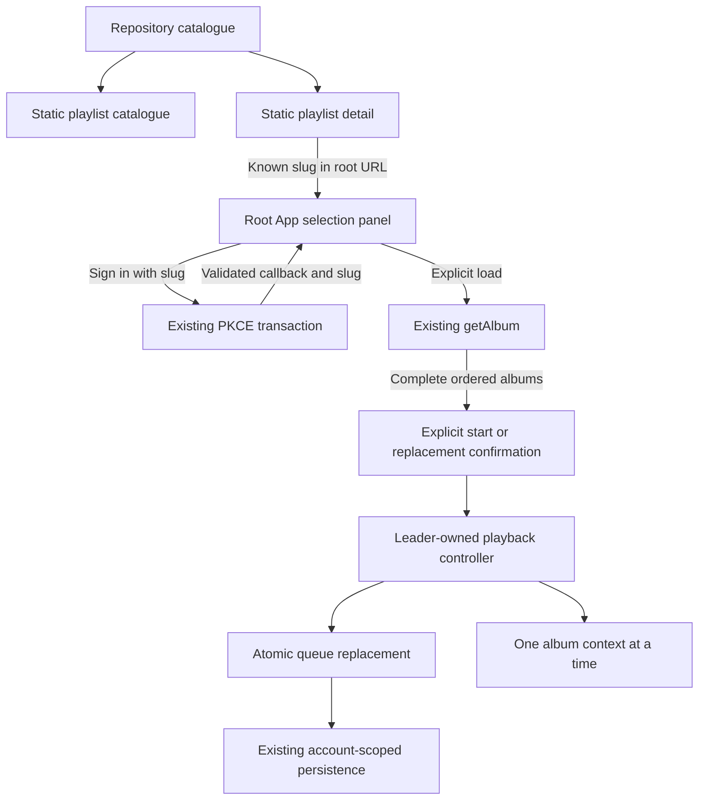
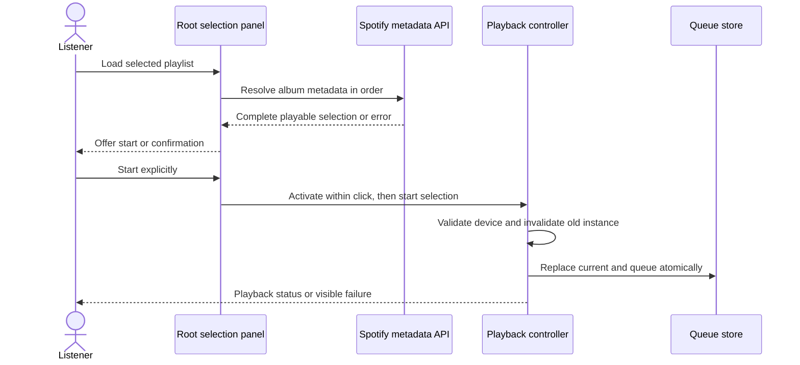
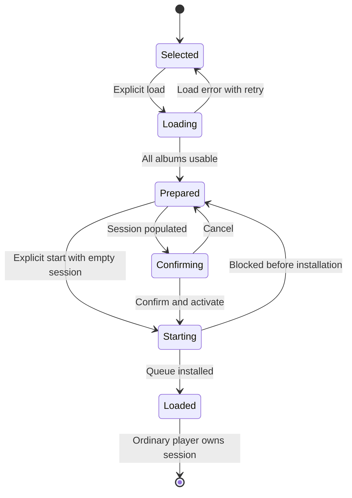

# Shared Album Playlists - Plan

## Goal Capsule

- **Objective:** Friends can open the same shared album selection and listen to its albums in order through their own eligible Spotify accounts.
- **Means:** Build-time curated pages and an explicit handoff to Vynl's existing player (KTD1, KTD3).
- **Authority:** Product behavior follows the Requirements below and the user's confirmed scope. Technical choices follow the Planning Contract within those constraints. `AGENTS.md` governs repository conventions.
- **Execution profile:** A bounded frontend feature on the existing static deployment, with focused queue/controller coverage before connecting the UI.
- **Stop conditions:** Stop for a product decision if implementation requires a backend, additional Spotify scopes, or silently discarding part of the selection. Do not promise unrestricted Spotify playback.
- **Delivery ownership:** Implementation includes the feature, related documentation, and verification. Committing, publishing, and opening a PR require separate authorization.

---

## Product Contract

### Summary

Add a public catalogue of platform-curated album playlists and a permanent page for each selection.
Seed the first selection from the supplied session, then let each listener load and play it through their own Vynl player.
There is no playlist editor or Spotify playlist creation in this version.

### Problem Frame

A queue saved in one browser is not a useful link to send a friend.
It combines an album selection with private listening progress, while the friend needs the selection independently of that progress and of the original listener's account.
Vynl currently offers album search and saved albums behind sign-in, but no public collection that another listener can inspect before connecting Spotify.

### Requirements

**Public discovery and sharing**

- R1. Anyone can browse the platform-wide playlist catalogue and open an individual playlist page without Spotify authentication or authenticated API requests.
- R2. Each playlist has a stable, directly loadable URL, a title, a short description, and its ordered albums with names, artists, artwork or a fallback, and Spotify album links.
- R3. The first playlist contains the ten albums in the seed manifest below, in exactly that order, starting at the beginning rather than the pasted playback position.
- R4. Sharing a playlist means sharing its public page URL, not exporting the visitor's account, credentials, queue edits, or listening position.

**Starting a selection**

- R5. The playlist's primary action takes the listener into Vynl's existing player flow, using that listener's Spotify account.
- R6. Sign-in preserves the selected playlist, but returning from OAuth, opening a link, reloading, or revisiting a page never starts playback or replaces the queue automatically.
- R7. Starting a selection replaces the current Vynl album and queued albums. If either is populated, the listener must confirm replacement; cancellation leaves them unchanged.
- R8. Before replacement, every selected album must resolve to usable playback metadata. A loading failure leaves the existing session unchanged and identifies the failure with a retry action.
- R9. A successful start puts the first album on the turntable at track zero and position zero, with the remaining albums queued in order.
- R10. Subsequent playback uses Vynl's existing whole-album progression, device selection, resume, and unavailable-album behavior.
- R11. Playback actions obey account verification, leader-tab ownership, Spotify eligibility, and player readiness. A blocked listener sees the existing relevant status and can still browse the public pages.
- R12. Repeated clicks and stale asynchronous work must not start a selection twice or apply it to a different account or a tab that has lost leadership.

**Compatibility and presentation**

- R13. Imported playback state remains in the listener's existing account-scoped storage. Editing that queue never changes the curated source.
- R14. Catalogue, detail, loading, and confirmation surfaces work on mobile and with keyboard navigation, following Vynl's palette and font conventions.
- R15. The feature remains deployable as a static GitHub Pages site under the configured base path.

### Key Decisions

- **A Vynl playlist is an ordered album selection, not a Spotify playlist.** This extends discovery without changing the album-only playback model. Governs R2, R9, R10.
- **Include the current album before the queued albums.** The user confirmed the proposed interpretation of the supplied session. Governs R3.
- **Replace with confirmation rather than append.** A friend should hear the shared selection in its intended order without accidentally discarding a listening session. Governs R7, R9.
- **Public browsing, existing Spotify playback eligibility.** A shared URL is accessible to everyone, but it does not grant Spotify API access. Governs R1, R5, R11.

### Seed Manifest

Initial editorial default: **Album rotation**, slug **`album-rotation`**.
Description: "Ten albums to put on, one after another."
The title and description are editable repository content; keep the slug stable once published.

The supplied version-1 export contains nine queued albums, one current album, and position `{ trackIndex: 0, positionMs: 32647 }`.
Only the selection is retained under R3.
This manifest preserves the required identities and ordering without depending on the original attachment remaining available.
Snapshot track counts are reference values, not runtime availability assertions.

| Order | Album | Artist | Spotify album ID | Snapshot tracks | Artwork image key |
|---|---|---|---|---|---|
| 1 | The Hand You've Been Dealt | Joker's Republic | `7jtE0xbYPrmEefrEqKWFha` | 12 | `ab67616d0000b273aefb1a2c7fb6a49c9d46205c` |
| 2 | Moonflower | Flying Raccoon Suit | `44ASESIE4S1Rw76k8AcRB5` | 13 | `ab67616d0000b27338ba2ace1702ff3a79123f05` |
| 3 | Vending Machine | Sad Snack | `4r9l0IE5BCE7WUl2f9Jx7e` | 9 | `ab67616d0000b27354639539edd0b54d2b5a1f6d` |
| 4 | At Least More Than Half-Way Dead | Sgt. Scag | `2zWSnM4pk3NaTGad8hH78l` | 11 | `ab67616d0000b273b069240261fbd22d8330f16f` |
| 5 | Harmonic Convergence | Mega Infinity | `6Or0QrFbkQ2rkbRJTUoCRz` | 10 | `ab67616d0000b2737b6b5dd577beb99fe357ef15` |
| 6 | Just Devils | PWRUP | `4KQq5k0VTTfRVYqplDihnd` | 12 | `ab67616d0000b273f540297b8d49e417560a0d8c` |
| 7 | That's Right! | The Agonizers | `15KlC2f68uX0tH0ccGkI4r` | 10 | `ab67616d0000b273c8f0e81a80a19c60547a2a71` |
| 8 | Treats | Poindexter | `582w4ysx1o6rfe291qUciG` | 10 | `ab67616d0000b273b7a651f64bba5fce52996683` |
| 9 | Disco Lunch | The Boy Detective | `3dg4N52mvnw0bOdgakVrWB` | 10 | `ab67616d0000b2737d80f4c668906b7d4d8b2c6b` |
| 10 | Work by Day, Skank by Night | Swashbuckling Doctors | `5pEODhluey5BQStCWB7QlE` | 11 | `ab67616d0000b2738e364f1c60b03d7819ac0c10` |

Artwork URLs use `https://i.scdn.co/image/` followed by the supplied key.
Album URIs use `spotify:album:` followed by the supplied ID.

### Acceptance Examples

- AE1. **Covers R1-R4, R15.** A signed-out friend opens the shared detail URL directly and sees all ten albums in manifest order without connecting Spotify.
- AE2. **Covers R5, R6, R11.** A signed-out listener chooses the playlist and signs in. The player remembers the selection and waits for an explicit start click.
- AE3. **Covers R7-R9.** A listener with an existing session loads the selection and confirms replacement. The first manifest album becomes current at zero, with nine albums queued; cancelling preserves the existing session.
- AE4. **Covers R8, R12.** Loading the sixth album fails, or the account changes during loading. No partial queue is installed and the listener can retry where appropriate.
- AE5. **Covers R10, R13.** Finishing the first album advances once to Moonflower. Reordering the local queue and refreshing does not alter the public selection.
- AE6. **Covers R6, R12.** Reloading the player after starting the selection does not replay the import or restart the first album.

### Scope Boundaries

No backend, CMS, runtime playlist discovery, user-created collections, personal share links, synchronized group listening, or Spotify playlist write endpoints.
The catalogue is repository-authored and changes through deployment.

No separate playback controller on catalogue/detail pages and no seamless cross-page audio persistence.
Astro navigation currently unmounts the player; solving persistent cross-route playback is a separate architectural change.

No automatic partial import or market-specific substitute selection.
A load failure is visible under R8; playback-time refusal remains governed by R10.
No application-wide cache or new retry service: the existing Spotify wrapper already owns refresh, rate-limit handling, and request timeouts.
Revisit caching only if measured loading latency or quota use justifies it.

Copying the public URL from the address bar satisfies sharing; native share sheets and clipboard UI are not required.

---

## Planning Contract

### Existing Behavior and Constraints

- `src/pages/index.astro` mounts a browser-only `App`; the signed-out branch of `src/components/App.tsx` does not expose playback state.
- `src/lib/store/queue.ts` separates `current` from `queue`. Its `playNow` action changes only the current album, so repeating it cannot implement R9.
- `src/components/App.tsx` owns leadership and the single controller. Its controller store adapter updates a synchronous ref before dispatching into React.
- `src/lib/playback/controller.ts` serializes Spotify commands, invalidates album instances, and advances automatically. `playAlbum` currently mutates the store before sending a command; command promises resolve even when failures become status or notices.
- `src/lib/spotify/api.ts` already fetches complete album tracks through `getAlbum`, including pagination, and centralizes API errors. `src/components/browse/AlbumCard.tsx` fetches full data only on selection.
- `src/lib/auth/session.ts` saves PKCE state and verifier. `src/components/auth/CallbackHandler.tsx` currently returns every successful sign-in to the root, with no selection context.
- `src/lib/store/persist.ts` already persists the desired album/current/position shape, while `AppState.tsx` adopts storage changes from other tabs. No saved-state schema migration is necessary.
- `astro.config.mjs` establishes static output, trailing slashes, the base path, and artwork CSP hosts. `src/lib/url.ts` is the URL authority.

### Key Technical Decisions

- KTD1. **Use a typed, repository-owned catalogue and prerendered Astro routes.** Add a small catalogue module containing playlist metadata and album summaries, a catalogue route, and a detail route generated with `getStaticPaths`. This meets R1, R2, R15 without a content service or content-collection framework. Astro's [routing guide](https://docs.astro.build/en/guides/routing/) establishes this build-time pattern.
- KTD2. **Store display snapshots; resolve playable albums only on an explicit load.** The source module uses the manifest's IDs, names, artists, and artwork. Fetch complete `Album` values through existing `getAlbum` sequentially in selection order, validating nonempty usable tracks before offering replacement. This follows `AlbumCard` and avoids publishing the original session's track snapshot as current availability. It satisfies R8 without adding ten API requests to every public page visit.
- KTD3. **Keep the player at the root and pass only a validated playlist slug.** Public detail actions link to the root with a `playlist` query parameter built using `appPath` and URL utilities. `App` displays a selected-playlist panel. Only an explicit start action invokes playback, per R5-R7; neither routes nor effects issue play requests.
- KTD4. **Carry the slug with the existing PKCE transaction.** Extend pending sign-in data with an optional known catalogue slug, not an arbitrary return URL or album payload. After a successful, state-validated token exchange, return the trusted selection to `CallbackHandler`, which reconstructs the root URL through `src/lib/url.ts`. Consume it with the transaction; ordinary sign-in still returns to the ordinary root. This is the smallest return-context change needed for R6 and avoids an open redirect.
- KTD5. **Make whole-selection start one controller-owned operation.** Add a queue replacement action that sets first/current, remainder/queue, and zero position in one reducer transition. Expose a controller command using that action rather than direct UI storage writes or repeated `add`/`playNow` calls. At execution, select an available device before mutation, cancel the old scheduler, invalidate its album instance and anchor, replace the queue, then start the first album through existing album-context logic. Share only necessary setup with `playAlbum`; do not rewrite the controller.
- KTD6. **Load before confirming; activate audio on the final click.** The root panel first loads playback data without changing the session. Its final start button or replacement-confirmation button synchronously calls controller activation before awaited work. Recheck verified account, current leadership, readiness, and latest session at that boundary. Invalidate loaded results and pending actions on account/selection changes or unmount. If a previously empty session becomes populated before commit, require R7 confirmation.
- KTD7. **Separate loading, queue installation, and playback acknowledgment.** The controller's resolved promise is not proof of audible playback. Use actual status/notices to describe playback success. Metadata failures leave the old session intact under R8; a Spotify command failure after installation leaves the selected queue available for retry or device selection, with the existing error/status visible. No misleading success banner or rollback that suggests Spotify playback was undone.
- KTD8. **Render public content without browser-only providers.** Use server-renderable React presentation components within Astro pages, with normal links rather than hydrated playback buttons. Public navigation can be a small shared Astro component. Do not mount `AppStateProvider`, fetch `/me`, or load the SDK there. The [framework-component guide](https://docs.astro.build/en/guides/framework-components/) supports static React rendering without client directives.

No bake-off is needed: the existing static routes and single-controller boundary resolve the mechanism choice.
A client-side router or second controller would require a wider change without improving the confirmed outcome.

### High-Level Technical Design

Selection/account changes invalidate preparation and return to Selected.
The URL identifies a selection, never an import instruction; no state above is resumed as an automatic start.

### System-Wide Impact

The only authentication change is carrying trusted catalogue identity through sign-in.
The only persisted playback change is new values in the existing shape.
The public routes do not participate in leadership; the root player remains the sole command owner.
The new controller method also requires updates to controller fakes in `src/components/App.test.tsx`.

### Risks and Dependencies

**Spotify access is the rollout constraint.**
The repository's `README.md` documents development mode.
Spotify's current [quota-mode documentation](https://developer.spotify.com/documentation/web-api/concepts/quota-modes) limits it to five allowlisted authenticated users and notes that non-allowlisted users can sign in yet receive API 403 responses.
Public pages can be shared widely; playback cannot be promised to arbitrary visitors under this app mode.
Keep the existing Premium/allowlist messaging and document this distinction near the action and in the README.

**Browser audio still requires interaction.**
The [Web Playback SDK documentation](https://developer.spotify.com/documentation/web-playback-sdk) notes autoplay limitations, especially on iOS.
KTD6 preserves activation in the final gesture; verify this with a real eligible account rather than claiming unit tests prove audibility.

**Catalogue availability varies over time and by listener.**
KTD2 resolves through the listener's account rather than using exported playback position or assuming all pasted tracks are available.
Keep quota and per-album failures visible; do not silently prune the selection.

**Controller observations can race with a new selection.**
KTD5 must ensure old end signals and remote scheduler work cannot advance the newly installed queue.
Use the existing fake SDK/API/scheduler harness to prove that transition before wiring the feature UI.

### Sources and Documentation

Use the existing patterns in `src/components/browse/AlbumCard.tsx`, `src/lib/playback/controller.ts`, `src/lib/store/queue.ts`, and `src/lib/auth/session.ts`.
The original album-player plan, `docs/plans/2026-10-29-1403-feat-spotify-vinyl-player-plan.md`, excludes Spotify playlists; this feature retains album contexts and adds a Vynl collection above them.
It does not introduce Spotify playlist playback.

Follow `AGENTS.md` and Astro's [component](https://docs.astro.build/en/basics/astro-components/) and [styling](https://docs.astro.build/en/guides/styling/) guidance.
Update `README.md` to explain curated pages, queue replacement, adding another repository-authored selection, and Spotify eligibility.

---

## Implementation Units

### U1. Define the curated catalogue and seed

**Goal:** Preserve the supplied selection as maintainable platform content.
**Requirements:** R2-R4, R13.
**Dependencies:** None.
**Files:** Create `src/lib/playlists/catalog.ts` and `src/lib/playlists/catalog.test.ts`.
**Approach:** Implement KTD1's typed catalogue with lookup by stable slug, using the Seed Manifest as the source. Reuse the existing `AlbumSummary` shape where practical. Validate editorial invariants in tests, not through a new runtime content framework.
**Patterns:** `src/lib/spotify/api.ts` album summaries and `src/lib/store/queue.ts` domain types.
**Test scenarios:**
1. The seed contains all ten manifest album IDs in exact order, with Joker's Republic first and Swashbuckling Doctors last.
2. Every playlist slug is unique and URL-safe, and every entry has a matching album URI, title, artists, and usable artwork URL or explicit null.
3. Known slug lookup returns the matching selection; unknown slug lookup cannot fall back to the first playlist.
4. Source data contains no current/position fields, account identifiers, or tokens.
5. Mutating a derived local queue does not change catalogue ordering.
**Verification:** A second catalogue entry can be added as data without introducing another page file.

### U2. Build public catalogue and detail routes

**Goal:** Make the selection discoverable and shareable before sign-in.
**Requirements:** R1, R2, R4, R14, R15; AE1.
**Dependencies:** U1.
**Files:** Create `src/pages/playlists/index.astro`, `src/pages/playlists/[slug].astro`, `src/components/playlists/PlaylistCatalog.tsx`, `src/components/playlists/PlaylistDetail.tsx`, `src/components/playlists/PlaylistPages.test.tsx`, and `src/components/playlists/PublicNav.astro`. Modify `src/components/Header.tsx`, `src/components/Header.test.tsx`, `src/lib/url.ts`, and `src/lib/url.test.ts`.
**Approach:** Apply KTD1, KTD3, KTD8. Use the existing `Base.astro` layout with playlist-specific titles. Public pages use shared static navigation and presentation components, not the browser-only App. Add a Playlists link to the existing signed-in and signed-out header. Include eligibility copy and a normal detail-page link to the root selection panel. Factor the existing Spotify album URL helper into a browser-safe shared location only if necessary to avoid importing playback-oriented components.
**Test scenarios:**
1. Covers AE1. Rendering public presentation without auth/store providers shows names, artwork/fallbacks, album links, and manifest order.
2. Catalogue cards link to distinct detail URLs, including a second fixture selection.
3. The detail action carries only the chosen slug to the root URL; playlist URLs respect both `/` and a configured base prefix with trailing slashes.
4. Header navigation exposes the catalogue while preserving existing sign-in, privacy, and drawer behavior.
5. Missing artwork preserves album identity and usable layout.
6. Generated production HTML contains catalogue/detail content without executing JavaScript; unknown slugs use the existing 404 behavior.
**Verification:** Direct navigation and refresh work for catalogue/detail pages in the built site, not just client-side navigation. Mobile layout has no horizontal overflow and keyboard users can reach every link.

### U3. Preserve selection through Spotify sign-in

**Goal:** Return a listener to the selected playlist in the player without autoplay.
**Requirements:** R5, R6, R11; AE2.
**Dependencies:** U1 and U2's URL helper.
**Files:** Modify `src/lib/auth/session.ts`, `src/lib/auth/session.test.ts`, `src/components/auth/CallbackHandler.tsx`, `src/components/auth/CallbackHandler.test.tsx`, `src/lib/url.ts`, and `src/lib/url.test.ts`.
**Approach:** Apply KTD4 within the existing PKCE transaction rather than a parallel persistent intent store. Preserve callback URL cleanup. Check the existing in-flight exchange deduplication still returns one consistent completion result. Leave requested scopes and registered redirect URI unchanged.
**Test scenarios:**
1. Covers AE2. A known playlist slug survives authorize/token completion and returns in the reconstructed player URL.
2. Ordinary sign-in without a selection retains today's root redirect.
3. Unknown slugs, external URLs, and malformed values cannot redirect outside Vynl or select an unrelated playlist.
4. A state mismatch, provider denial, or token-exchange failure does not consume an unrelated selection as a successful login or touch playback storage.
5. Callback remounts share the existing single token exchange, and successful completion does not leave reusable pending selection state.
6. Callback completion never calls a playback controller.
**Verification:** The callback's trusted data comes from the matching PKCE transaction, not arbitrary callback query parameters.

### U4. Start an ordered selection through the playback controller

**Goal:** Replace a session as one coherent playback operation.
**Requirements:** R7, R9-R13; AE3, AE5.
**Dependencies:** None; exercise with existing album fixtures.
**Files:** Modify `src/lib/store/queue.ts`, `src/lib/store/queue.test.ts`, `src/lib/playback/controller.ts`, `src/lib/playback/controller.test.ts`, `src/lib/store/persist.test.ts`, and controller fakes in `src/components/App.test.tsx`. Extend `src/test/fakes/spotifyWebApi.ts` only if a required response cannot already be expressed.
**Approach:** Apply KTD5 and KTD7. Keep replacement in the controller's serialized command boundary, with device validation before destructive changes. Reuse existing album-context start and error reporting. Do not change the meaning of ordinary single-album `playAlbum` or queue actions.
**Execution note:** Add the replacement and stale-end-signal scenarios before changing controller behavior; they are the proof that integration can safely replace a live session.
**Test scenarios:**
1. Covers AE3. Starting three albums installs the first/current and two/queue in one state transition and sends an album-context play request at zero.
2. Replacement resets a nonzero saved position without modifying the source album list.
3. No available device, an empty selection, or a disposed controller produces no destructive replacement and no success-shaped response.
4. An old album-end SDK event or pending remote scheduler signal does not skip the new first album.
5. Covers AE5. A new album's real completion advances exactly once to the second selection album.
6. A Spotify failure after installation produces the existing notice/status and retains the installed selection for recovery.
7. Existing single-album play, unavailable queued-album skip, previous/next, device transfer, and resume behaviors remain unchanged.
8. The new state saves and reloads through the existing account namespace and version.
**Verification:** The fake SDK/API integration observes both store replacement and the correct Spotify command, not merely a mocked controller invocation.

### U5. Connect selection loading, confirmation, and player UI

**Goal:** Let a listener deliberately start the shared selection without losing a session during preparation.
**Requirements:** R5-R14; AE2-AE6.
**Dependencies:** U1-U4.
**Files:** Create `src/lib/playlists/load.ts`, `src/lib/playlists/load.test.ts`, `src/components/playlists/PlaylistStart.tsx`, and `src/components/playlists/PlaylistStart.test.tsx`. Modify `src/components/App.tsx`, `src/components/App.test.tsx`, and `README.md`.
**Approach:** Read the known selected slug in the root App and pass the selection into a panel inside the existing authenticated Shell. Keep signed-out selection context visible and pass it to sign-in. Resolve albums under KTD2, then apply KTD6 and KTD7. Do not treat `getLastAccount` alone as verified identity: gate the new operation until `/me` has confirmed the account. Keep the existing selected-slug URL inert after starting so refresh cannot replay it.
**Test scenarios:**
1. Covers AE2. A signed-out selection is shown with sign-in; a verified leader can load it and gets an explicit start action afterward.
2. Complete loading preserves order even when metadata differs from snapshots, and no store mutation occurs while loading.
3. Covers AE3. Existing current-only, queue-only, and playing sessions each require confirmation; cancel leaves current, queue, and position unchanged.
4. Covers AE4. A failed album load, empty track list, auth failure, or quota error leaves the old session untouched and exposes the relevant error and retry.
5. Covers AE4. Switching accounts, changing the selected slug, losing leadership, or unmounting invalidates an in-flight load before it can commit.
6. A persisted last-account value while `/me` is pending cannot receive the selection.
7. If the session becomes populated between preparation and start, the final action requests confirmation rather than overwriting silently.
8. The final start/confirm click activates synchronously, disables duplicate submission, and invokes the real selection-start boundary once.
9. Followers, Starting, AuthLost, NotAllowlisted, and PremiumRequired states cannot submit playback. SDK-unavailable listeners retain the existing device recovery path.
10. Covers AE6. Revisiting or refreshing a selected-slug URL does not replace state or issue playback automatically.
11. Confirmation has a named dialog, predictable initial focus, keyboard cancel, and focus restoration; loading/errors use existing status and alert conventions.
**Verification:** An App integration test uses real queue state and the fake playback boundary to demonstrate selection handoff, replacement, persistence, and account isolation. README content distinguishes public browsing from Spotify playback access.

---

## Verification Contract

Implementation, not this planning run, performs the following checks.
Use `bun run test` with the affected paths while working; never `bun test`.

| Check | Coverage | Expected result |
|---|---|---|
| Targeted Vitest tests | U1-U5 test files listed above | Seed order, safe sign-in handoff, non-destructive loading, coherent replacement, and regression cases pass |
| `bun run check` | Astro, React, TypeScript | Routes, props, controller interface, and updated fakes type-check |
| `bun run build` | Static output and CSP | Catalogue and every known detail route emit HTML under the configured base without a server or credentials |
| Built-site inspection | Public routes and unknown slug | Direct page loads and refresh show content without JavaScript; unknown detail URL does not show the first playlist |
| Browser exercise | Eligible Premium account at the repository-approved local origin | Signed-out selection survives OAuth, requires a fresh gesture, and plays the correct album on the listener's account |
| Responsive/accessibility exercise | Narrow mobile and desktop, keyboard | Artwork fallback, navigation, loading, and confirmation remain usable |

The Spotify browser exercise must cover an existing queue, confirmation cancellation, actual audible start, transition to the second album, and reload without re-import.
Use `http://127.0.0.1:4321/vynl/`, never localhost.
Do not claim fake SDK tests prove real audio or bypass development-mode eligibility.
No new browser-testing dependency is required for this feature.

---

## Definition of Done

- U1's catalogue preserves the manifest and supports additional repository-authored selections.
- U2's public routes satisfy AE1 and remain directly shareable without login.
- U3's sign-in handoff satisfies AE2 without changing Spotify scopes or allowing arbitrary redirects.
- U4's controller transition satisfies AE3 and AE5 without regressing existing playback behavior.
- U5's loading, confirmation, and lifecycle handling satisfy AE4 and AE6, with the documented Spotify limitation visible to listeners.
- The Verification Contract has evidence for the implemented behavior; any unavailable live-account exercise is reported explicitly rather than marked passed.
- Related README documentation is updated, no private session data is committed, and abandoned experiments or unused helpers are removed.