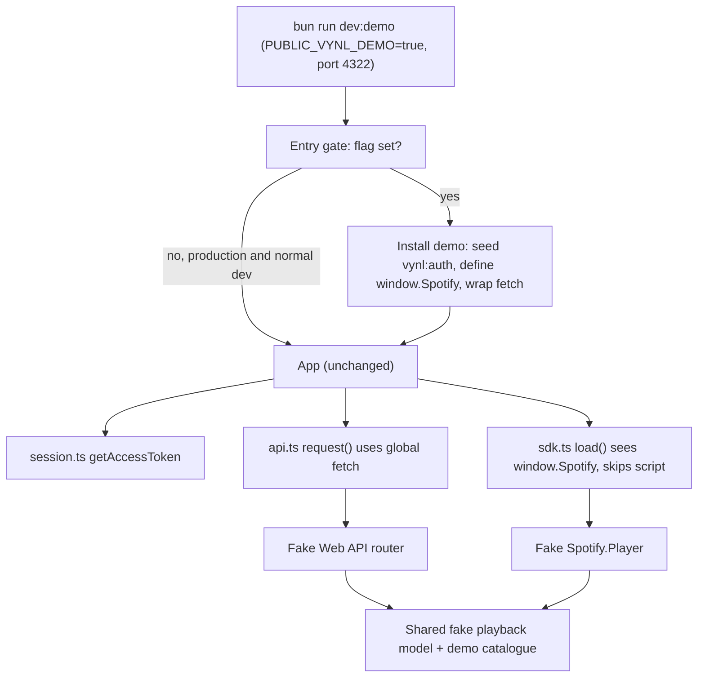

# Responsive Layout Fix and Local Demo Mode - Plan

## Goal Capsule

- **Objective:** The player stays readable and usable at every window width, with or without the album drawer open, and anyone can see and check the full player locally without a Spotify account.
- **Means:** The album drawer overlays the page below wide-desktop widths instead of pushing it aside (KTD1, KTD2). A dev-only demo command fakes Spotify at the browser boundary with seeded data (KTD3–KTD6).
- **Product authority:** This plan governs the layout and the demo. `docs/plans/2026-10-29-1640-feat-responsive-playback-layout-plan.md` still governs where the queue, track list and devices sit, and this plan changes only the breakpoints at which that placement applies.
- **Execution profile:** Build the demo first (U1–U3) so the layout fix (U4) can be checked visually against it.
- **Stop conditions:** Stop and ask if keeping the demo out of the production build would need changes to Spotify auth, API or SDK modules beyond a build-time gate.
- **Finishing and shipping:** `ce-work` implements and verifies. The repository owner reviews and merges.

---

## Product Contract

### Summary

Fix the overlapping player layout by letting the album drawer slide over the page with a backdrop on all but wide screens. Show the desktop track rail only when there is room for it. Add `bun run dev:demo`, which runs the real app on its own local address with fake albums, tracks, devices and playback, and which never ships in the production build.

### Problem Frame

With the album drawer open at tablet-like widths (about 640–1100px), the page keeps its two-column desktop grid and adds 25rem of left padding to clear the drawer. In the reported 776px window, that leaves the turntable column only a few pixels wide. The cover, track title, controls, Devices button and Up next heading end up stacked on top of each other and on top of the track rail.

Bugs like this are hard to catch because the player only renders after a Spotify Premium sign-in on an allowlisted account, with a real album loaded. There is no way to look at a populated UI locally or try it at different widths without that setup.

### Requirements

**Layout**

- R1. At every viewport width from 320px up, with the album drawer open or closed, the turntable, now-playing text, playback controls, Devices, queue and track list never overlap each other.
- R2. Below wide-desktop widths, the open album drawer overlays the page with a dimmed backdrop. Clicking the backdrop, pressing Escape or using its close control closes it and returns focus to the header toggle.
- R3. On wide-desktop widths, the open album drawer keeps pushing the player aside, as it does today.
- R4. The desktop track-list rail appears only at widths where the player column keeps a usable width next to it. Below that, the existing Tracks button and right-hand drawer are used.
- R5. Long album, artist and track names wrap or truncate inside their own area and never spill over neighbouring content.

**Demo mode**

- R6. A single local command starts the app signed in as a demo listener, with saved albums, search results, a loaded album, a queue and devices, all from fake data and with no Spotify account or network access to Spotify.
- R7. In demo mode, play, pause, next, previous, choosing a track, Play now, Add to queue, queue reordering and device transfer all work against the fake data, and the turntable and tonearm respond as they would with Spotify.
- R8. The demo runs on a different local origin from the normal dev server, so its sign-in and saved queue never overwrite a real Spotify session in the same browser.
- R9. Demo code and data are absent from the production build output.
- R10. The demo data includes layout stress cases: very long album, artist and track names, an album with 30 or more tracks, an album with a single track, and an empty queue reached by clearing the seeded one.

### Key Decisions

- **The album drawer overlays rather than pushes below wide desktop.** Pushing only works when the drawer, player and track rail all fit side by side. Governs R2, R3. (session-settled: user-approved — chosen over always pushing: pushing is what crushes the player at mid widths)
- **The demo runs as its own dev command on a separate local address.** Governs R8. (session-settled: user-approved — chosen over a toggle on the normal dev server: a shared origin would share `vynl:auth`, the saved queue and the leader lock with the real session)
- **The demo fakes Spotify so the controls really work.** Governs R7. (session-settled: user-approved — chosen over a static mock-up: a static page can't show the turntable, tonearm or queue changing state)
- **The demo data deliberately includes awkward content.** Governs R10. (session-settled: user-approved — chosen over tidy sample data: the reported bug is the kind tidy data hides)

### Scope Boundaries

- **In scope:** Shell grid and drawer behaviour across breakpoints, text overflow in the player, a local demo command with fake data, and its README entry.
- **Out of scope:** Changes to playback, queue, Spotify request, auth or persistence behaviour. Changes to the turntable artwork. Deploying the demo anywhere.
- **Considered and not built:** Making the overlay drawer a full modal with a focus trap and `inert` page. The drawer already handles Escape, close and focus return, and the backdrop closes it on click. Revisit if keyboard users report tabbing behind the overlay as a problem.
- **Considered and not built:** A "Demo" badge in the UI. The demo runs on its own port from its own command, so nobody reaches it by accident. Revisit if the demo is ever deployed.
- **Considered and not built:** Automated visual-regression or browser tests. happy-dom can't measure layout, and adding Playwright is a new toolchain. Visual checks happen by hand against the demo (Verification Contract).

#### Deferred to Follow-Up Work

- Moving the Vitest fakes in `src/test/fakes/` onto the same browser fake used by the demo, so tests and demo share one fake Spotify.

### Acceptance Examples

- AE1. **Covers R1, R2.** Given a 776px-wide window with an album loaded, when the listener opens the album drawer, then the drawer slides over a dimmed page, and clicking the dimmed area closes it and focuses the header toggle.
- AE2. **Covers R3, R4.** Given a 1440px window with the drawer open, when the player renders, then the drawer sits on the left, the turntable column is next to it, and the track rail is on the right, with nothing overlapping.
- AE3. **Covers R4.** Given an 800px window, when an album is loaded, then no track rail shows and the Tracks button opens the track drawer.
- AE4. **Covers R6, R8.** Given a browser signed in to real Spotify at `http://127.0.0.1:4321/vynl/`, when the developer runs the demo command and opens its address, then the demo shows fake albums, and the real tab is still signed in with its queue intact.
- AE5. **Covers R9.** Given a production build, when the output is searched for demo-only data, then none is found.

---

## Planning Contract

### Key Technical Decisions

- KTD1. **The drawer pushes only from the `xl` breakpoint (1280px) up, and the push padding matches the drawer width.** Drawer (24rem), track rail (20rem), gaps, padding and a comfortable turntable column add up to about 74rem, so `xl` is the first standard breakpoint where all three fit. Below `xl`, the shell drops its left padding and the drawer renders a backdrop. Implements the overlay-below-wide-desktop Key Decision (governs R2, R3).
- KTD2. **The track rail moves from `md` to `lg`, and the Tracks drawer covers everything below `lg`.** At 768–1023px the 20rem rail leaves too little for the turntable even with the drawer closed. `TrackListPanel` already renders both forms, so this is a change of breakpoint classes on the opener, mobile drawer, desktop rail and the shell's grid columns. Serves R4.
- KTD3. **The demo fakes Spotify at the browser boundary, not inside app modules.** The demo installs a fake `fetch` for `api.spotify.com` and `accounts.spotify.com`, defines `window.Spotify` before the app starts, and seeds a long-lived `vynl:auth` token. `loadScript` in `src/lib/player/sdk.ts` already skips the SDK script when `window.Spotify` exists, and every Web API call goes through the global `fetch` in `request()` in `src/lib/spotify/api.ts`. So `session.ts`, `api.ts`, `sdk.ts` and `controller.ts` run unchanged, and the demo exercises the real playback state machine. Chosen over injecting fake `api`/`sdk` objects through `ControllerOptions`, because that would bypass auth, `getMe`, the browse drawer and `DevicePicker`, which call `api.ts` directly. Implements the working-controls Key Decision (governs R7).
- KTD4. **One fake playback model drives both the fake Web API and the fake SDK player.** Play, pause, skip and transfer commands update a single in-memory state. `GET /me/player` reads that state, with progress advancing on the clock while playing. The fake SDK player emits `ready` and `player_state_changed` from the same state when the tab is the active device. This mirrors `FakeLive` in `src/test/fakes/spotifyWebApi.ts`, so poll and SDK views never disagree.
- KTD5. **The demo is gated by `import.meta.env.DEV` and a `PUBLIC_VYNL_DEMO` flag together, and the demo code is loaded with a dynamic import inside that branch.** Vite replaces both statically. `DEV` is always false in `astro build`, so the branch is dead and Rollup drops the dynamic chunk even if the flag leaks into a production environment. A runtime switch such as a query parameter would ship the fake in the bundle. Serves R9. The gate must finish installing the fakes before `App` first renders, because `App` reads `isSignedIn()` during its initial state.
- KTD6. **`dev:demo` runs `astro dev` on port 4322 with the flag set.** `http://127.0.0.1:4322/vynl/` is a separate origin from 4321, so `localStorage`, `BroadcastChannel` and Web Locks are isolated without renaming any keys. Implements the separate-address Key Decision (governs R8). The `strictPort` and `127.0.0.1` host in `astro.config.mjs` stay as they are, and the command passes the port.
- KTD7. **Fake album art is generated as SVG `data:` URIs from palette OKLCH values.** The CSP's `img-src` already allows `data:`, so no `public/` files enter the production build and no CSP change is needed. Generated art also keeps hex colours out of the codebase, in line with AGENTS.md.

### High-Level Technical Design

How the demo starts, and where the fakes meet the real code:

Layout by width (album loaded):

| Width | Album drawer open | Track list |
|---|---|---|
| under `lg` (under 1024px) | Overlays with backdrop | Tracks button and right drawer |
| `lg` to under `xl` (1024–1279px) | Overlays with backdrop | Right rail |
| `xl` and up (1280px+) | Pushes the player right | Right rail |

### Assumptions

- `bun run` runs `package.json` scripts through a shell that accepts inline `VAR=value` prefixes on macOS and Linux. Windows contributors aren't supported for the demo command.

---

## Implementation Units

### U1. Demo catalogue

- **Goal:** Fake albums, tracks, search results, devices and the demo account, shaped like the existing Spotify response types.
- **Requirements:** R6, R10
- **Dependencies:** None
- **Files:** `src/demo/catalogue.ts`, `src/demo/catalogue.test.ts`
- **Approach:**
  1. Define about 12 saved albums and a separate set of search results, built as `SpotifySimplifiedAlbum` and `SpotifyTrack` values from `src/lib/spotify/types.ts`, so the real mappers in `api.ts` convert them.
  2. Include the R10 stress cases: a 60+ character album name, a multi-artist album, track names over 50 characters, an album with 32 tracks and one with a single track.
  3. Generate cover art per KTD7.
  4. Define two or three devices besides the demo tab.
  5. Define a demo user.
- **Patterns to follow:** Fixture shapes in `src/test/fakes/spotifyWebApi.ts` and `src/components/App.test.tsx`.
- **Test scenarios:**
  - Every album has a unique id and `spotify:album:` URI, and every track a unique `spotify:track:` URI.
  - The catalogue contains at least one album with 30+ tracks, one with exactly one track, and one name longer than 60 characters.
  - Every cover art value is a `data:image/svg+xml` URI.
- **Verification:** The catalogue type-checks against the Spotify types and the tests pass.

### U2. In-browser fake Spotify

- **Goal:** A plain browser module, with no Vitest imports, that installs the fake Web API, token endpoint and SDK player over the catalogue.
- **Requirements:** R6, R7
- **Dependencies:** U1
- **Files:** `src/demo/fakeSpotify.ts`, `src/demo/fakeSpotify.test.ts`
- **Approach:**
  1. Write an `install` function that seeds `vynl:auth` with a far-future expiry, defines `window.Spotify` with a fake `Player`, and wraps `globalThis.fetch` so only Spotify hosts are faked. Any other request falls through to the real `fetch`.
  2. Route each endpoint that `api.ts` calls: `/me`, `/me/albums` with offset paging, `/search`, `/albums/{id}`, `/albums/{id}/tracks`, `/me/player`, `/me/player/devices`, play, pause, next, previous, transfer and repeat. Return status codes as Spotify does, for example 204 for commands.
  3. Answer the token endpoint with a fresh token, so a refresh never signs the demo out.
  4. Hold one playback model per KTD4. The fake player's `connect` emits `ready` with a demo device id, and state changes emit `player_state_changed`.
  5. Make `install` safe to call twice. A second call is a no-op.
- **Patterns to follow:** `stubSpotifyWebApi` routing and `FakeLive` progress in `src/test/fakes/spotifyWebApi.ts`. `FakeSpotifyPlayer` listener handling in `src/test/fakes/spotifySdk.ts`.
- **Test scenarios:**
  - After install, `isSignedIn()` is true and `getMe()` resolves to the demo user.
  - `getSavedAlbums(0)` returns the first page with a `nextOffset`, and the last page returns `nextOffset: null`.
  - `searchAlbums('any text')` returns the demo search results.
  - `getAlbum` for the 32-track album returns all 32 tracks across the tracks paging.
  - `play` with an album context and offset, then `getPlaybackState`, reports that track playing on the demo device, with progress growing as fake time advances.
  - `pause`, then `getPlaybackState`, reports `is_playing: false` with progress held.
  - `next` on the last track of an album ends playback rather than wrapping.
  - `transferPlayback` to another device makes `getPlaybackState` report that device, and the fake SDK player emits a state showing the tab is no longer playing.
  - `sdk.load()` resolves without appending a `<script>` to the document, and `getDeviceId()` returns the demo tab id.
  - A request to a non-Spotify URL reaches the original `fetch`.
- **Verification:** The real `api.ts` and `sdk.ts` modules work against the fake in tests, with no edits to either.

### U3. Demo command and build gate

- **Goal:** `bun run dev:demo` starts the app pre-populated on its own origin, and production builds carry none of it.
- **Requirements:** R6, R8, R9
- **Dependencies:** U2
- **Files:** `package.json`, `src/pages/index.astro`, `src/components/Root.tsx` (new), `src/components/Root.test.tsx` (new), `src/vite-env.d.ts` or the existing env typing location, `README.md`
- **Approach:**
  1. Add a `dev:demo` script per KTD6.
  2. Add a small root component that `index.astro` mounts in place of `App`. When the flag (KTD5) is set, it dynamically imports `src/demo/fakeSpotify.ts`, calls `install`, and only then renders `App`. Otherwise it renders `App` straight away.
  3. Seed the demo account's saved state (a loaded album part-way through, plus a queue) on first install only, so a developer's demo changes survive reloads. The empty-queue case (R10) is reached by clearing the queue in the UI.
  4. Type `PUBLIC_VYNL_DEMO` alongside `PUBLIC_SPOTIFY_CLIENT_ID`.
  5. Add a README row for `bun run dev:demo` with its address, and a note that the demo state lives only in that origin's storage.
- **Patterns to follow:** `client:only="react"` mounting in `src/pages/index.astro`. The command table in `README.md`.
- **Test scenarios:**
  - With the flag unset, the root renders `App` on the first render and never imports the demo module.
  - With the flag set, the root renders nothing until install finishes, then renders `App` signed in with the turntable showing the seeded album.
  - Covers AE5. A production build output, even with `PUBLIC_VYNL_DEMO=true`, contains no demo-only catalogue strings. This is a one-off build check recorded in the Verification Contract, not a Vitest test.
- **Verification:** `bun run dev:demo` opens at `http://127.0.0.1:4322/vynl/` signed in with albums, a loaded record and a queue. Play, pause, skip, choosing a track, Play now, queue moves and device transfer all respond. `http://127.0.0.1:4321/vynl/` in the same browser is unaffected.

### U4. Responsive shell, drawer backdrop and text overflow

- **Goal:** No overlap at any width with the drawer open or closed.
- **Requirements:** R1, R2, R3, R4, R5
- **Dependencies:** U3 for visual verification only. The code doesn't depend on it.
- **Files:** `src/components/App.tsx`, `src/components/browse/BrowseDrawer.tsx`, `src/components/turntable/TrackListPanel.tsx`, `src/components/turntable/Turntable.tsx`, `src/components/App.test.tsx`, `src/components/browse/BrowseDrawer.test.tsx`, `src/components/turntable/TrackListPanel.test.tsx`, `src/components/turntable/Turntable.test.tsx`
- **Approach:**
  1. Shell grid in `App.tsx`: per KTD2, move the two-column grid from `md` to `lg`. Per KTD1, apply the drawer push padding only at `xl` and make it match the drawer's `md:w-96`.
  2. `BrowseDrawer`: when open, render a backdrop below `xl` that is hidden from assistive technology and closes the drawer on click through the existing close-and-refocus path. The backdrop sits under the drawer and over the page.
  3. `TrackListPanel`: change the opener, mobile drawer and rail breakpoint classes from `md` to `lg`, per KTD2.
  4. `Turntable` now-playing text: let the track title and album line wrap with `break-words`, or clamp them, within the `min-w-0` text column. Keep the cover fixed.
  5. Check the controls-and-devices row and the queue items at the narrowest player column once the steps above are in. Tighten only what still overlaps in the demo.
- **Execution note:** Use the demo (U3) at 320, 375, 776, 1024, 1280 and 1440px, with the drawer open and closed, as the main proof. happy-dom can't measure layout, so unit tests only guard the classes and behaviour.
- **Patterns to follow:** `close()` and focus return in `BrowseDrawer.tsx`. Palette-only colour classes per AGENTS.md, for example a `bg-night-bordeaux/60` or `bg-neutral-950/60` backdrop.
- **Test scenarios:**
  - Covers AE1. With the drawer open, clicking the backdrop closes the drawer and moves focus to the header toggle.
  - With the drawer closed, no backdrop is rendered.
  - Covers AE2. With the drawer open, the `app-body` element carries the push padding only under the `xl:` prefix, and no `md:` push padding remains.
  - Covers AE3. The track rail has `hidden` and `lg:block`, and the Tracks opener and mobile drawer hide at `lg`. Update the existing `md` assertions in `App.test.tsx` and `TrackListPanel.test.tsx`.
  - The now-playing title element carries a wrapping or clamping class, so a 120-character track name stays inside its column.
  - Existing Escape and close-button behaviour of both drawers still passes unchanged.
- **Verification:** At each listed width in the demo, nothing overlaps (R1). The reported 776px drawer-open view shows the drawer over a dimmed page.

---

## Verification Contract

| Gate | Command or check | Applies to |
|---|---|---|
| Unit tests | `bun run test` (never `bun test`) | All units |
| Type check | `bun run check` | All units |
| Production build excludes demo | `PUBLIC_VYNL_DEMO=true bun run build`, then search `dist/` for a distinctive demo catalogue string and for `fakeSpotify`. Expect no matches. | U3 |
| Demo smoke | `bun run dev:demo`, open `http://127.0.0.1:4322/vynl/`, and exercise R7's controls | U2, U3 |
| Origin isolation | With a real session open at `http://127.0.0.1:4321/vynl/`, run the demo. The real tab stays signed in with its queue unchanged. | U3 |
| Visual layout | In the demo, at 320, 375, 776, 1024, 1280 and 1440px, with the album drawer open and closed and the stress albums loaded, nothing overlaps | U4 |

---

## Definition of Done

- Every requirement R1–R10 is met, and AE1–AE5 hold when checked by hand or by test.
- All Verification Contract gates pass.
- No production module under `src/lib/` changes behaviour. Changes there are limited to env typing.
- No hex colours or inline `style` attributes are added, and internal links still go through `src/lib/url.ts`.
- README documents `bun run dev:demo`.
- Code from dead-end or experimental attempts is removed from the diff.
